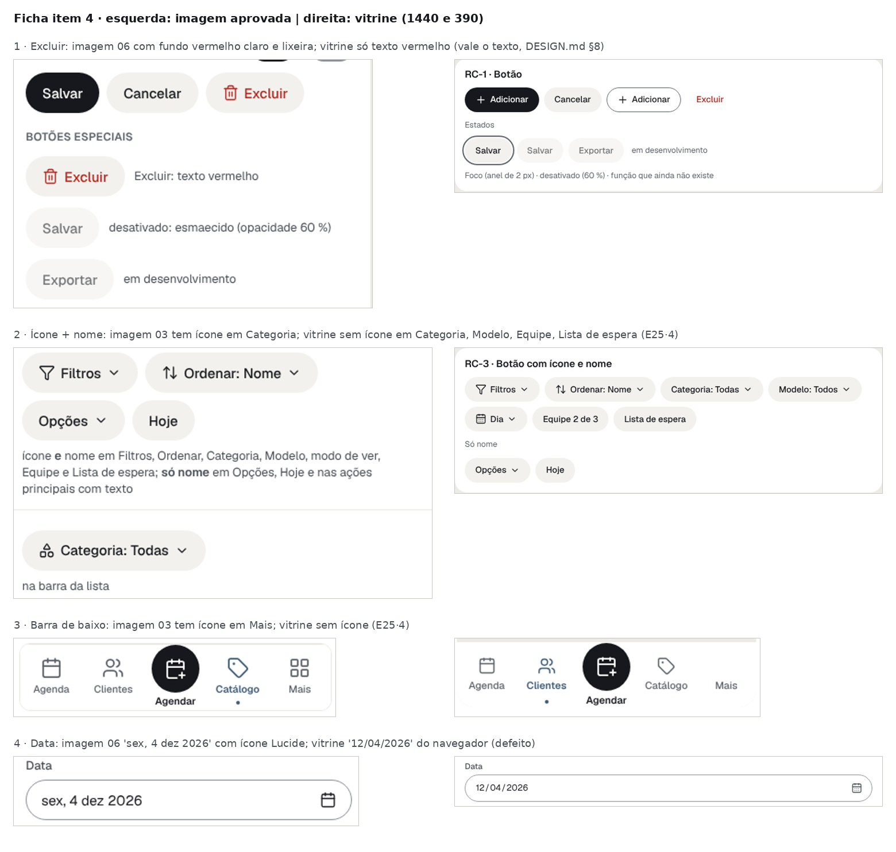

Papel: Designer de produto · Norma: WCAG 2.2, Material Design e Apple HIG

# Ficha visual · item 4 (design system no código) · E25

- **Antes:** imagens aprovadas [01](../../docs/design/imagens/01-hierarquia.png),
  [02](../../docs/design/imagens/02-cores-e-texto.png), [03](../../docs/design/imagens/03-controles.png),
  [06](../../docs/design/imagens/06-campos-camadas-estados.png).
- **Depois:** vitrine em 1440 e em 390 (dados fictícios):
  [computador](ficha/vitrine-computador.png) · [celular](ficha/vitrine-celular.png) ·
  camadas abertas: [menu 1440](ficha/vitrine-computador-menu.png) · [janelinha 1440](ficha/vitrine-computador-janelinha.png) ·
  [painel 1440](ficha/vitrine-computador-painel.png) · [menu 390](ficha/vitrine-celular-menu.png) ·
  [janelinha 390](ficha/vitrine-celular-janelinha.png) · [folha 390](ficha/vitrine-celular-folha.png).
- **Lado a lado:** [ficha/lado-a-lado.png](ficha/lado-a-lado.png).
- **Revisor de design:** aprovou sem bloqueio; pediu incluir os ícones do menu ⋮ na decisão de ícones (feito, E25·2).

## Bate (igual)
- **01 Hierarquia:** uma ação preta por quadro; seletor com o escolhido em branco; item atual do menu em fundo claro
  com ícone azul ardósia (#3E5C76, medido na captura, nos dois menus e na barra de baixo); controles sobre branco.
- **02 Cores e texto:** os 21 tokens com nome e valor iguais ao `DESIGN.md` §3, mais os 3 de §5/§8b (#8A5205,
  rgba(22,24,29,.07), #D8D7D1); escala Geist 20 a 11.
- **03 Controles:** Adicionar preto e com contorno; Opções ▾; botões de ícone sem fundo; Filtros/Ordenar/Dia com ícone;
  Opções e Hoje só nome; seletor que rola com esmaecido; buscas; contador cinza e âmbar; funil + 2 e sininho + 3;
  etiquetas e status com os ícones Lucide de §5; Agendar 52; barra do topo na ordem de §8b; seções com pílula e ›;
  Total ▴.
- **06 Campos, camadas, estados:** campos (rótulo, * cinza, erro vermelho com ícone, ▾, várias linhas), caixinha e
  interruptor pretos, desativado 60 %, "em desenvolvimento", aviso com Desfazer, estados vazio, sem resultado,
  carregando e erro; menu aberto branco com sombra (Editar · Duplicar · Arquivar · Excluir, nesta ordem);
  janelinha com Cancelar e Excluir; folha de baixo com canto no topo e "Mostrar 8 clientes" preto; painel à direita
  com 480 (1440 − 960, medido na captura).

## Diverge (com a causa)
| # | O quê | Causa | Classe |
|---|---|---|---|
| 1 | Excluir (botão e janelinha): imagem 06 tem fundo vermelho claro e lixeira; vitrine só texto vermelho, sem fundo e sem ícone | `DESIGN.md` §8 "Excluir com texto vermelho"; ícone não nomeado | diferente, vale o texto; a imagem 06 deve ser corrigida depois |
| 2 | Categoria, Modelo, Equipe e Lista de espera sem ícone (imagem 03 tem ícone em Categoria; §5 pede "ícone e nome") | o `DESIGN.md` não diz qual ícone | lacuna → E25·2 |
| 3 | "Mais" da barra de baixo sem ícone (imagem 03 tem quatro quadrados) | ícone não nomeado | lacuna → E25·2 |
| 4 | Menu ⋮ sem ícones; imagem 06 tem ícone em Editar, Duplicar e Arquivar | o `DESIGN.md` não nomeia esses ícones | lacuna → E25·2 (apontada pelo Revisor de design) |
| 5 | Seções Modelos (`tag`) e Termos (`lock`) repetem ícones que já são Catálogo e Bloqueio de horário | §5 "um ícone por coisa"; ícone das seções não nomeado | defeito → E25·2 e depois o Engenheiro |
| 6 | Janelinha aberta sem fundo escurecido atrás; quadrado da inicial do estúdio com 32 | o `DESIGN.md` não fixa a cor nem o tamanho | lacuna → E25·2 |
| 7 | Data "12/04/2026" com o ícone do navegador; imagem 06 "sex, 4 dez 2026" com o calendário Lucide | campo de data do navegador | defeito (volta ao Engenheiro) |
| 8 | Cabeçalho de grupo "Sobrancelhas" com faixa colorida; na prova 3 a faixa fica só nas linhas | §3 "faixa de 4 px à esquerda da linha" | defeito leve |
| 9 | Estado vazio com ícone `tag`; imagem 06 usa estrelinhas | estrelinhas não nomeadas; `tag` é o ícone de Catálogo (serviços) | diferente, vale o texto |
| 10 | "Onde estou" incoerente: título Catálogo e menu aberto marcando Clientes; barra de baixo marca Clientes na tela Formulários | dado de exemplo | defeito leve |
| 11 | Texto "Zero não aparece: []" (colchetes soltos); campo de nota com a alça de redimensionar do navegador | dado de exemplo / navegador | defeito leve |

## Decisões do dono (as 3 da spec)
- **E25·1 · Onde a vitrine fica.** A: só em desenvolvimento e na prévia · B: também na produção, atrás do login.
  **Recomendo A.**
- **E25·2 · Medidas e ícones que o `DESIGN.md` não fixa** (é o que aparece na tela).
  A: como no canvas aprovado e nas imagens: forte = 600; altura de linha 1,2 nos títulos e 1,4 no texto; ícones Lucide
  com traço 1,75 e os ícones de função do canvas; mais Categoria `shapes` e Mais `layout-grid` (os da imagem 03),
  Equipe `briefcase` (o do módulo Equipe, "um ícone por coisa"), Modelo e seção Modelos `layout-template`, Termos
  `file-text`, Lista de espera `list-ordered`; menu ⋮ Editar `pencil`, Duplicar `copy`, Arquivar `archive` (os do
  quadro `K6Campos`, conferidos traço a traço com o pacote Lucide); fundo escurecido `rgba(22,24,29,.40)` (`--dim`
  do canvas v6); quadrado da inicial 32 com canto 10 (`.logo` do canvas v6). Tudo gravado no `DESIGN.md`.
  B: o Designer propõe outros valores, e os botões e as seções ficam sem ícone até o mapa de ícones (quadro
  `L7Icones`) ser aprovado.
  **Recomendo A:** é o que as imagens aprovadas mostram, e §5 pede ícone e nome nesses botões.
- **E25·3 · Largura em que vira computador.** A: 840 px (Material Design 3) · B: outra. **Recomendo A.**

**Desfaz-se assim:** cada item é um token ou um nome de ícone; troca-se em uma linha do `DESIGN.md` e do código.
**Responda:** os códigos, por exemplo "E25·1A E25·2A E25·3A".

## Dados
Só nomes fictícios (Lia Moura, Tomás Faria, Nina Seixas; serviços e valores de exemplo); nenhum dado de saúde,
telefone completo ou e-mail nas capturas (RV-2).

## Não verificado
- O fundo escurecido não aparece em nenhuma captura; o comportamento esperado depende da E25·2.
- Medidas finas (alturas, folgas, larguras) e contraste: só a olho na captura; a prova é dos testes CA-4 e CA-5.
- Os nomes Lucide da E25·2 existem no pacote instalado (`lucide-react`); a correspondência de `shapes` e
  `layout-grid` com a imagem 03 é a olho.
- Foco por teclado, leitor de tela e movimento reduzido: não testados aqui.
