# Ficha visual · Agenda (versão 4: respostas E59 e E60)

- **Spec:** `spec.md` (§3, §4, RF-01 a RF-15, RF-21, RF-22, RN-03 a RN-10, CA-05, CA-13, CA-15, CA-16; respostas na
  §16 e na §17) · **Tarefa:** P3
- **Escrito por:** Designer de produto · **Norma:** WCAG 2.2, Material Design, Apple HIG · **Fonte:** só o `DESIGN.md`
  (as peças e nomes desta ficha já estão nele, §7b, com o código de cada resposta)
- **Inspiração:** referência do dono (capturas de outro sistema no celular, enviadas em 28/11; **nenhuma imagem dele
  entra no repositório** e nada foi copiado). Ideia aproveitada: o botão do meio da barra de baixo abre as opções de
  criar. Formatos de visão, escala de tempo e configuração dos cartões ficam para a spec seguinte (E57·B).
- **Revisado por:** Revisor de design, 3ª rodada na v3 (Libera com ressalvas, corrigidas). **A v4 ainda não foi
  revista.** Respostas do dono E59 e E60 aplicadas (fala literal na spec, gravada pelo Analista de requisitos).
- **Protótipo:** HTML estático fora do repositório, com o CSS real do item 4; fonte Geist; ícones Lucide; capturas com
  Playwright (Chromium), 390 × 844 e 1440 × 900, escala 2×. Dados fictícios: equipe Ana Souza (dona), Bruna Reis,
  Carla Lima; sábado, 28 nov 2026; "agora" = 14:20 (21:40 na imagem da grade alargada até a hora atual).

---

## Respostas do dono aplicadas (E59 e E60, 28/11)
- **E59·A:** grade de 08:00 a 20:00 que se alarga com item fora e até a hora atual (ADR 0006 D17).
- **E60·1·A:** bloqueio dentro do botão de criar e no toque do horário vazio; fora de Opções.
- **E60·2:** botão do meio da barra do celular só com o ícone `calendar-plus`, sem nome escrito; nome no leitor "Adicionar"; abre as mesmas opções; vale para a barra de todo o app.
- **E60·3·A:** linha do agora em azul ardósia (`--id`).
- **E60·4:** botão Equipe com ícone de pessoas ("bonequinhos"; qual deles, E63); a profissional não vê o botão (Assumption abaixo).
- **E60·5:** o nome é "Adicionar" (`DESIGN.md` §6 "Adicionar ▾"): "+ Adicionar ▾" abre Novo agendamento · Bloquear horário; "Novo" sozinho sai de tudo (botão, folha, barra).

## Decisões do Designer (v4)
- **Botão do topo com texto, não o "+" redondo (imagens 4 e 5 do dono):** no computador fica "+ Adicionar ▾" preto com nome (§5 e §6); o "+" redondo preto seria uma 2ª peça preta ao lado do botão da barra (§1) e ícone sozinho em ação não universal (§5); texto visível é mais claro (Nielsen 6; WCAG 2.5.3).
- **Agenda no celular sem "+ Adicionar" no topo:** quem cria na Agenda é o botão do meio da barra; um segundo caminho igual no topo repetiria a ação e não cabe no cabeçalho (☰, título, lupa, funil, sininho, Sua conta). Nas outras telas, "+ Adicionar" com contorno no topo continua (§5).
- **Botão do meio só ícone:** círculo 52 preto, alvo ≥ 44 (WCAG 2.5.8), `aria-label="Adicionar"`, `aria-haspopup="dialog"` e `aria-expanded` (WCAG 4.1.2); o círculo fica centrado na barra de 72.
- **Botões claros nos estados (imagem 6 do dono):** "Limpar filtros", "Tentar de novo" e "Ver equipe" em botão claro `--btn` (camada Controle sobre superfície, §2; é o que a imagem 06 aprovada mostra); a v3 tinha "Limpar filtros" e "Ver equipe" só com contorno, sobre branco. "Bloquear horário" e "Novo agendamento" dos vazios seguem com contorno, como o §8 manda para "Adicionar <coisa>" no vazio; trocar esse contorno por cinza muda regra aprovada e não foi feito.
- **Grade alargada até a hora atual:** se agora é 21:40, a grade vai até 22:00 e abre rolada com a hora atual à vista; sem rolar além do fim da grade.
- **Ícone de pessoas no Equipe (E60·4), escolha do Designer, a confirmar pelo dono (E63):** o dono pediu "bonequinhos", mas não decidiu a exceção ao "um ícone por coisa" (§5): `users` já é Clientes. As imagens principais estão com `users` até a resposta; o estado "sem profissional" usa o mesmo ícone do botão.

---

## Imagens

| Antes | Celular (390) | Computador (1440) |
|---|---|---|
| Tela inicial de hoje |  |  |

| Depois · estado | Celular (390) | Computador (1440) |
|---|---|---|
| Barra de baixo do celular, antes ("Agendar") × depois (só o ícone `calendar-plus`, nome no leitor "Adicionar"; vale em todo o app; E60·2) | 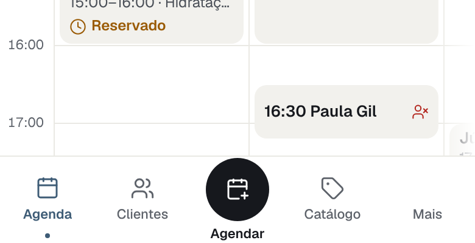 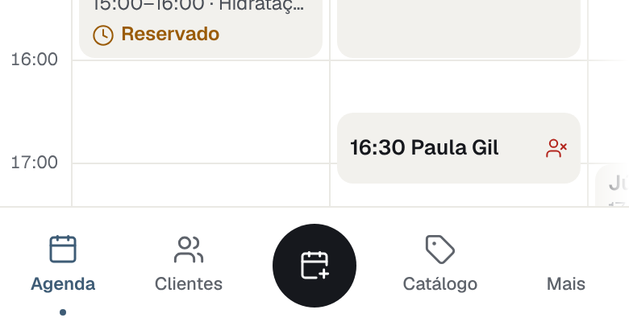 | — |
| Dia, dona ou recepção (todas as colunas; linha do agora às 14:20; grade E59·A) |  |  |
| Dia, profissional (só a própria coluna; sem "Equipe"; E58·A) | 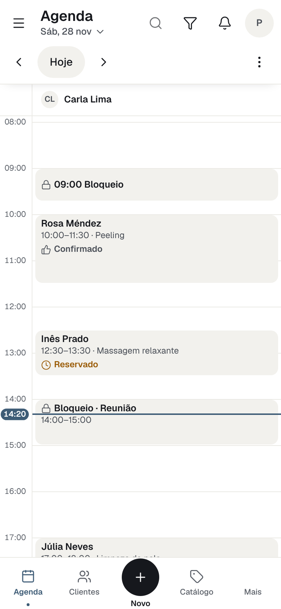 | 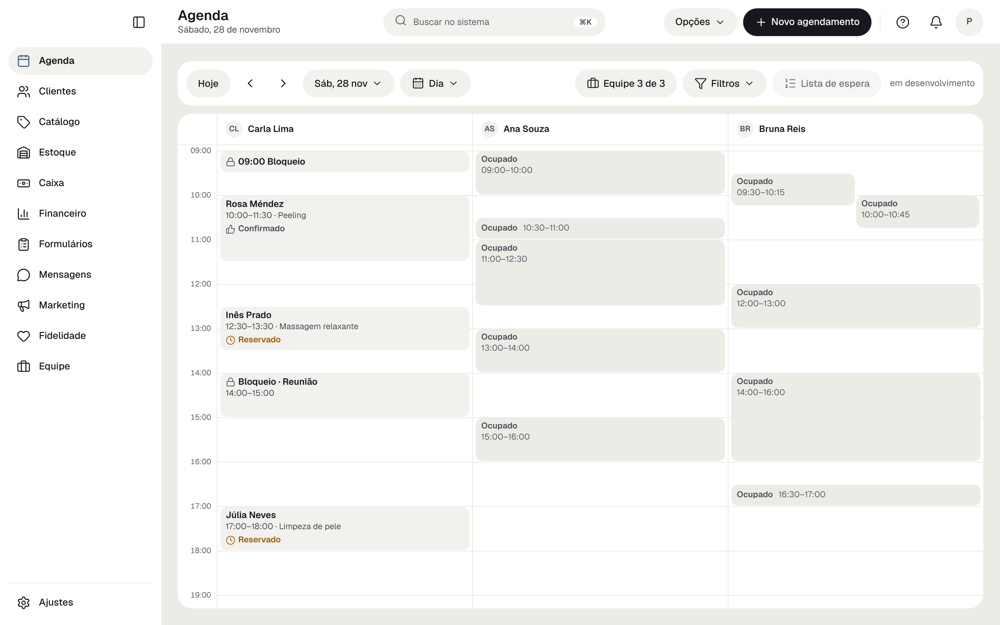 |
| "+ Adicionar ▾" aberto (folha "Adicionar" no celular), na v1 ("Novo agendamento" em desenvolvimento; "Bloquear horário" funciona; E60·1·A, E60·5) | 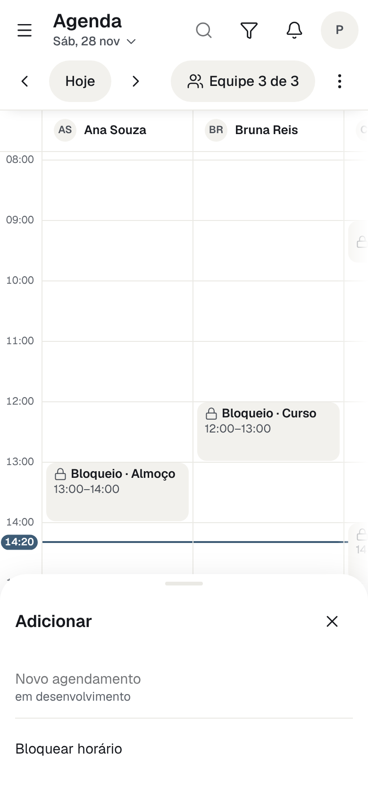 | 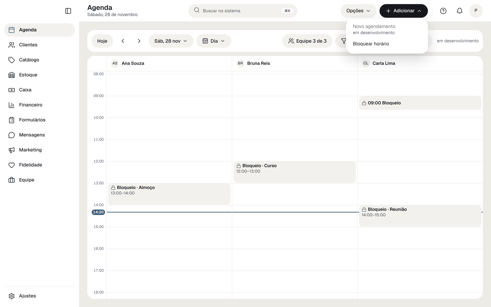 |
| Toque num horário vazio, na v1 (marca 1 h e abre o menu com a hora e a pessoa; "Novo agendamento" em desenvolvimento; E54·1) |  |  |
| E59·A, grade alargada (bloqueio às 06:30 abre a grade às 06:00) |  |  |
| E59·A, grade alargada até a hora atual (agora 21:40: vai até 22:00) | 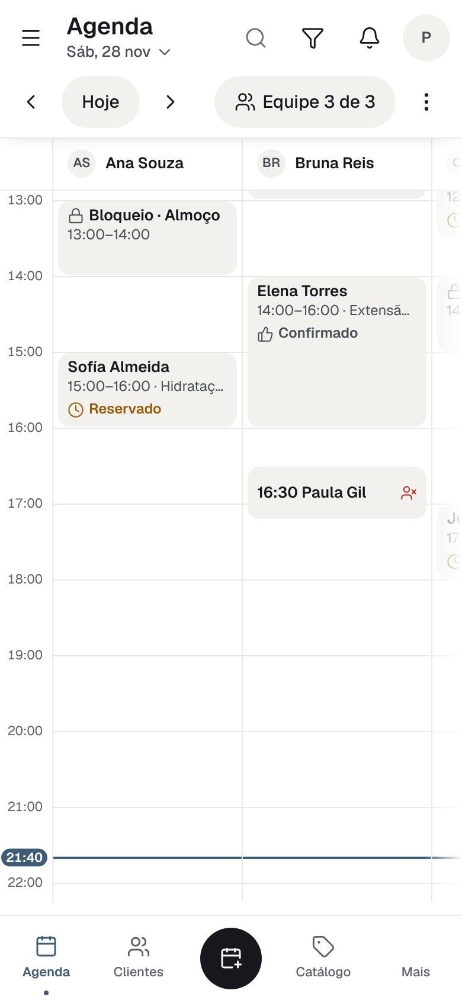 | 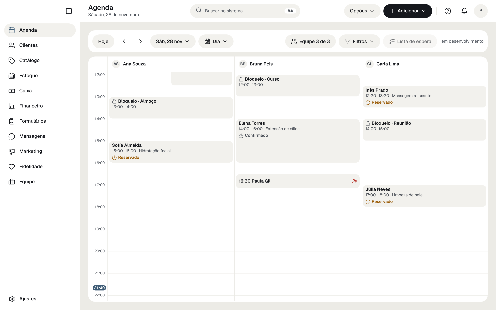 |
| Celular, pior caso: 3 itens que se cruzam e itens de 15 e de 5 min |  | 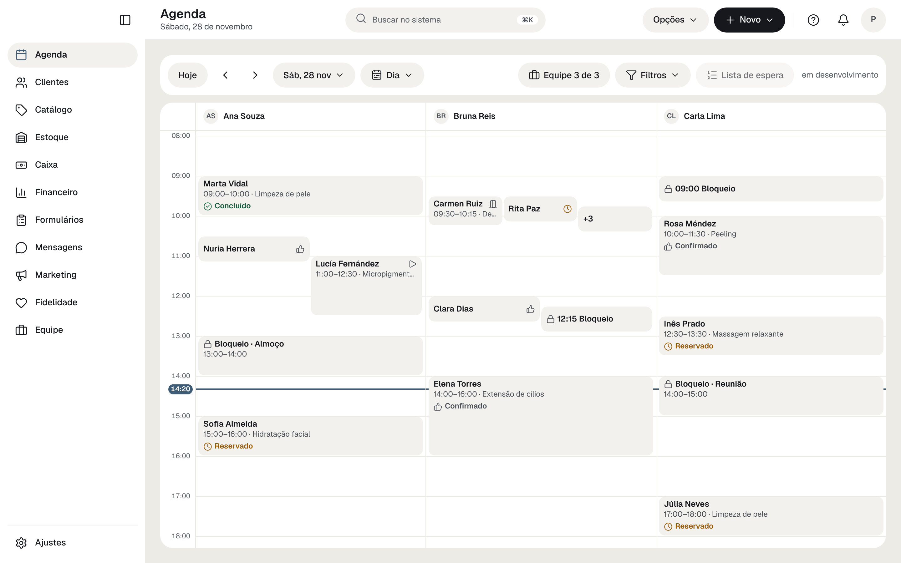 |
| Dia na v1, antes do Agendamento (só bloqueios) |  | 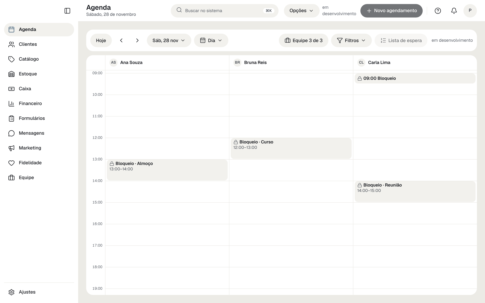 |
| Vazio na v1 ("Bloquear horário") |  |  |
| Vazio com o Agendamento ("Novo agendamento") |  |  |
| Carregando |  |  |
| Erro |  |  |
| Sem resultado (filtro esconde tudo; "Limpar filtros" em botão claro) | 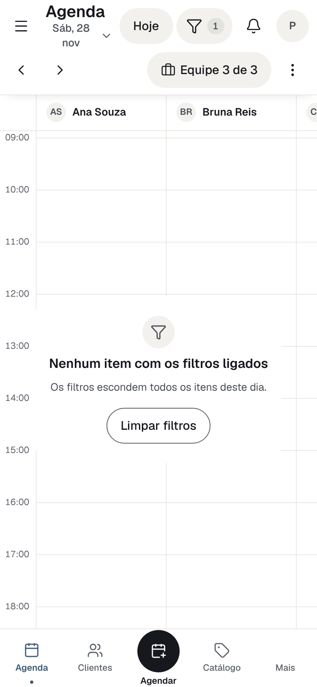 |  |
| Sem profissional | 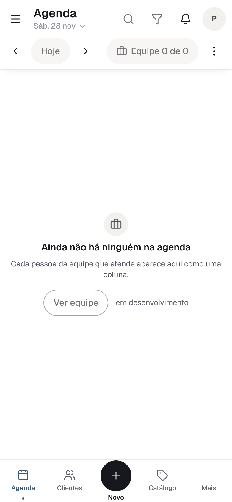 |  |
| Passou do teto de itens (RN-08) |  | 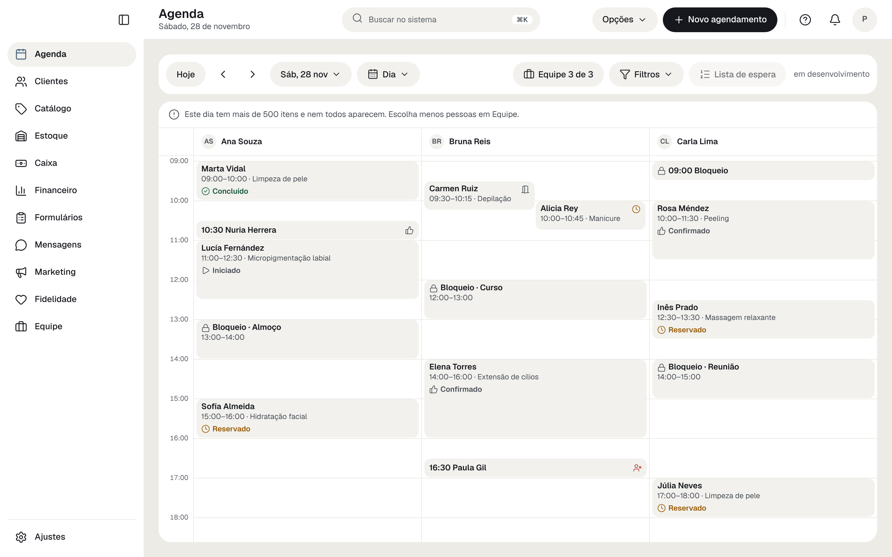 |
| Opções aberto (Exportar e Imprimir em desenvolvimento; sem "Bloquear horário") |  |  |
| Lupa do celular em desenvolvimento (aviso ao tocar; E57·B) | 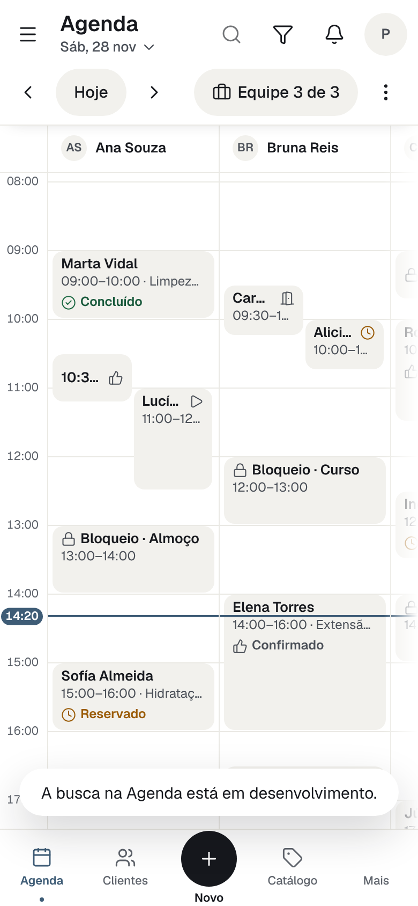 | — (no computador há a busca geral) |
| Modo de ver (outros formatos em desenvolvimento; E57·B) |  |  |
| Equipe 2 de 3 | 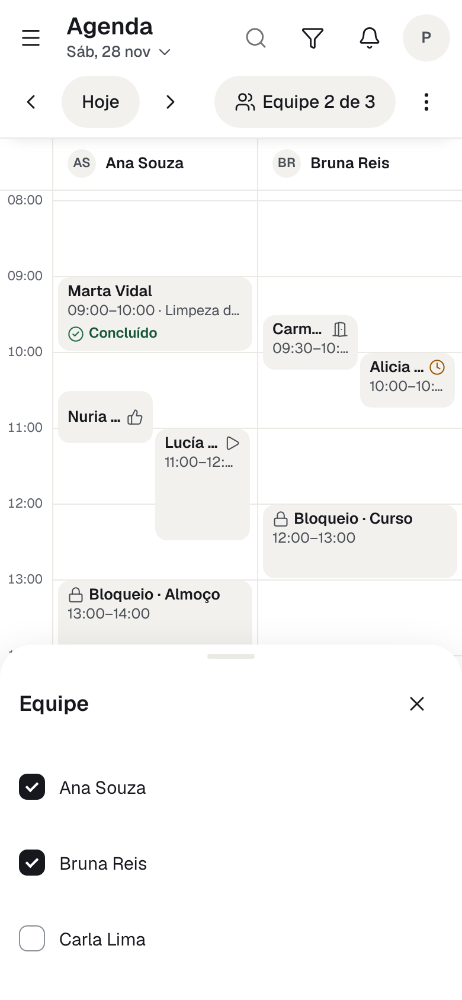 |  |
| Filtros (Cancelado desligado por padrão, RN-06) |  |  |
| Bloqueio · criar a partir do horário vazio (13:00–14:00, nasce com 1 h; atalhos de motivo) |  | 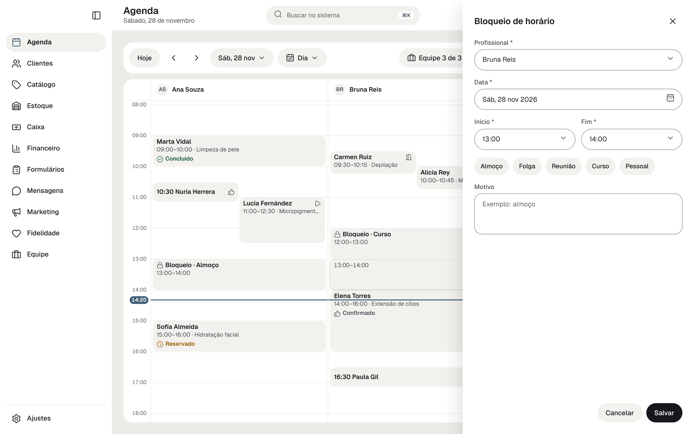 |
| Bloqueio · lista de horários aberta (passo de 15 min, sem digitar; E54·5 trocada) |  |  |
| Bloqueio · criar (profissional: campo só leitura) | 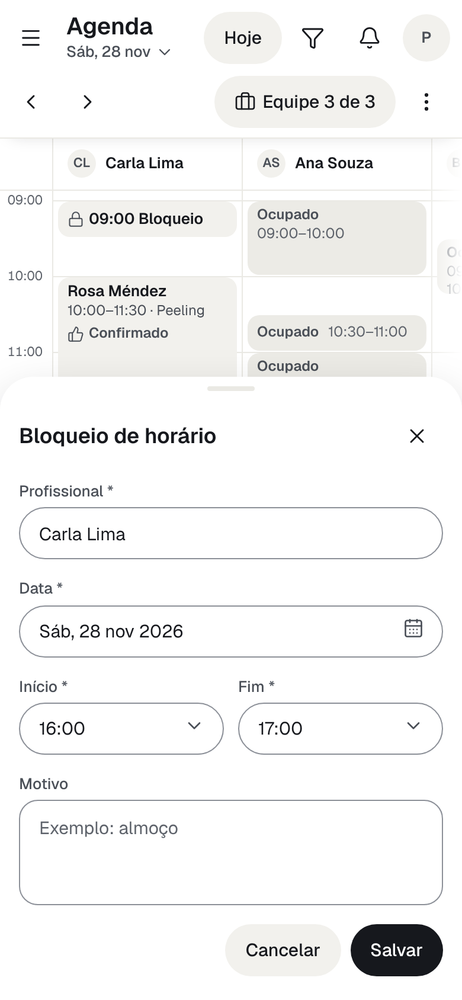 |  |
| Bloqueio · editar, com ⋮ aberto (Excluir) |  | 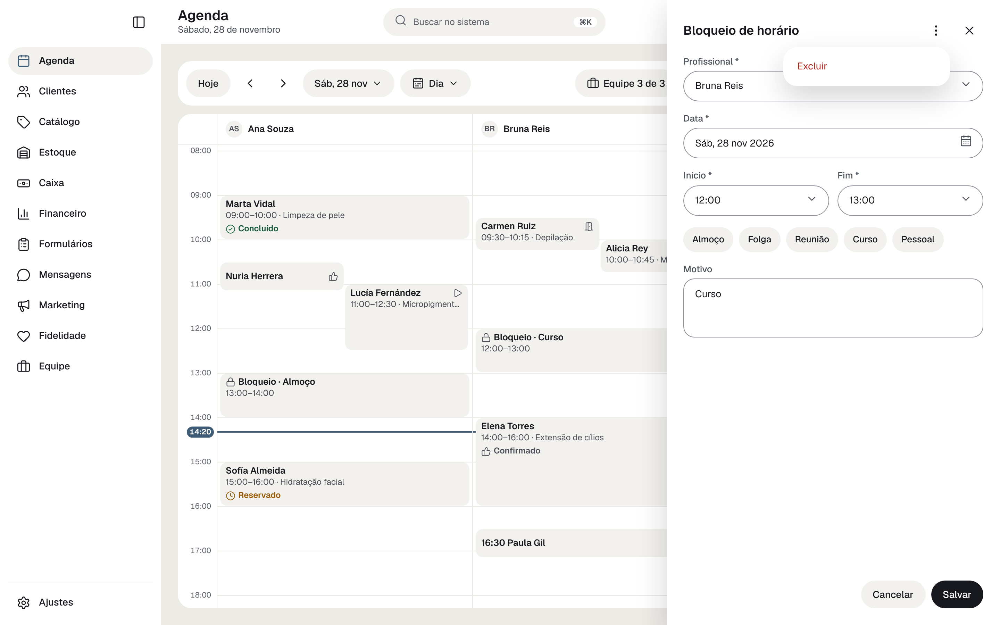 |
| Bloqueio · conflito recusado (RN-04) | 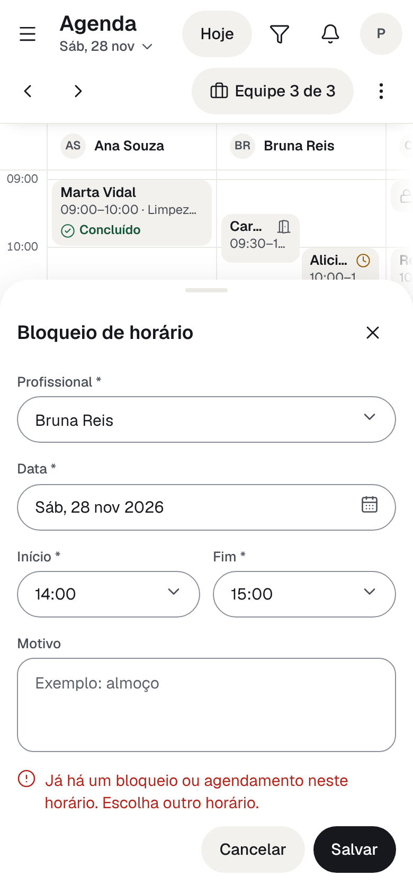 |  |
| Bloqueio · excluir, janelinha sobre o painel |  |  |
| Bloqueio · excluído, aviso com "Desfazer" |  |  |

Saíram da ficha (respondidas ou sem efeito): a alternativa E59·B (24 h) e `agenda-novo-aberto` (virou
`agenda-adicionar-aberto`) na v4; as alternativas E55·1·B, E55·1·C, E55·3·B e E55·4·B;
`agenda-opcoes-bloquear` (virou `agenda-opcoes`); `agenda-filtros-profissional` (com a E58·A a profissional só tem a
própria coluna, e a frase "Os filtros valem só para a sua coluna." deixou de ter sentido).

## Decisões do Designer em vigor (v3, ajustadas pela v4)

1. **Bloqueio dentro do "+ Adicionar ▾", sem botão separado nem configurador (E60·1·A).** Entradas: "+ Adicionar ▾" ›
   "Bloquear horário", o toque num horário vazio (E54·1) e, no vazio da v1, "Bloquear horário" com contorno. **Motivo:**
   uma só peça preta por tela (`DESIGN.md` §1 e §5); toque no horário vazio é o atalho rápido (Nielsen 7). Padrão de
   mercado: botão de criar que abre um menu curto (Material "menu" de botão; Apple HIG "pull-down button").
   "Bloquear horário" fica fora de Opções (E55·4 trocada).
2. **Celular: o botão do meio da barra vira só ícone (E60·2).** Mesmo lugar, mesmo círculo preto de 52, ícone
   `calendar-plus`, sem nome escrito; nome no leitor "Adicionar"; abre a folha "Adicionar" com as mesmas opções do
   computador. **Custo:** marcar um agendamento no celular tem um toque a mais (Adicionar › Novo agendamento). A barra é
   a mesma em todo o app; nas outras telas, o botão abre a mesma folha (o que mais entrar nela vem com pedido do dono,
   RF-08).
3. **Nome do botão (E60·5): "Adicionar ▾"**, como o `DESIGN.md` §6 já manda para o botão que cria mais de um tipo. O ▾ e
   `aria-haspopup="menu"` dizem que abre opções; "Novo agendamento" é item do menu (nome do §6).
4. **Linha do agora em `--id` (azul ardósia).** 2 px na largura das colunas, **atrás dos cartões** (passa só no espaço vazio e nunca encosta no texto), sem receber toque;
   na coluna das horas, a hora em pílula `--id` com texto branco 11 forte ("14:20"); o leitor de tela ouve "Agora,
   14:20". Só aparece quando o dia à vista é hoje; anda a cada minuto, sem animação. **Motivo:** o `--id` é "onde
   estou", e a linha diz onde se está no tempo; vermelho é erro, preto é ação (`DESIGN.md` §3). Contraste: branco sobre
   `--id` 7,0:1; linha sobre branco 7,0:1 (≥ 3:1, WCAG 1.4.11). Uso do `--id` gravado no §3 (E60·3·A).
5. **Profissional (E58·A, E60·4): sem "Equipe".** Com uma coluna só, o botão não teria o que escolher; some, como manda a
   RF-11 (esconder o que não se usa). Para dona e recepção, o botão "Equipe N de M" usa o ícone de pessoas (E60·4; qual deles, E63). A coluna ocupa a largura toda nas duas larguras. Filtros continuam.
6. **Toque no horário vazio (E54·1):** o toque cai no quarto de hora tocado (arredonda para baixo) e marca **1 h** a
   partir dali, no desenho do escolhido do seletor (`--btn` com o anel `--selRing`), porque o bloqueio nasce com 1 h
   (E54·4) e a pessoa vê antes o que vai criar. Abre um menu (computador) ou uma folha (celular) com a hora e a pessoa
   no topo ("13:00 · Bruna Reis") e "Novo agendamento" · "Bloquear horário". Quem não pode gravar naquela coluna não vê
   o menu (RF-13). **Teclado:** cada coluna tem um ponto de Tab "horário vazio"; ↑ e ↓ andam de 15 em 15 min pelos
   horários livres; Enter abre o menu; Esc fecha e volta o foco (WCAG 2.1.1 e 2.4.3).
7. **"+ Adicionar ▾" › "Bloquear horário" (sem hora tocada):** Data = o dia à vista; Início = o próximo quarto de hora depois
   de agora, se o dia é hoje, ou o início da grade (08:00 na E59·A), em outro dia; Fim = Início + 1 h (RN-10);
   Profissional vazio e obrigatório para dona e recepção (evita bloquear a pessoa errada), a própria para a
   profissional.
8. **Seletor de horário (E54·5 trocada, RN-09):** Início e Fim são botões de seleção (`role="combobox"` só de
   escolha) que abrem a lista dos horários de 15 em 15 min do dia, com o atual marcado (fundo `--btn`, forte e ✓) e
   rolado até ele; não há campo de digitar. O Fim mostra só horários depois do Início. Quando o Início passa do Fim, o
   Fim vira Início + 1 h e o leitor anuncia "Fim mudou para 17:00" (`aria-live`, WCAG 4.1.3).
9. **Atalhos de motivo (E54·3, RF-22):** acima do campo Motivo, cinco botões claros em pílula, 36 de altura com área de
   toque 44: Almoço · Folga · Reunião · Curso · Pessoal. Tocar **troca** o texto do Motivo pelo do atalho (não soma) e
   põe o foco no campo, que continua editável. Sem estado "ligado": o resultado está no próprio campo (Nielsen 1). No
   390 quebram em duas linhas, sem rolagem escondida.
10. **Opções:** funciona e abre Exportar e Imprimir, os dois "em desenvolvimento" (igual ao "Dia ▾"); no celular é o ⋮
    da faixa.
11. **Lupa do celular (E57·B):** no cabeçalho, antes do funil, esmaecida, mas tocável (`aria-disabled`, nome "Buscar
    na agenda, em desenvolvimento"); tocar mostra o aviso "A busca na Agenda está em desenvolvimento." (no 390 não cabe a
    nota ao lado). O `DESIGN.md` §5 já admite a lupa sozinha na Agenda do celular.

## Comportamento (para quem constrói e para o e2e)
- **Uma peça preta:** "+ Adicionar ▾" (computador) e o botão só ícone no meio da barra de baixo (celular), nas duas funcionando na v1
  (o bloqueio existe). Dentro, "Novo agendamento" fica "em desenvolvimento" até a spec do Agendamento (RF-08); o toque
  num cartão de agendamento também. Painel, folha e janelinha abertos têm o próprio preto (Salvar, Mostrar N itens), e
  a tela de trás não conta (`DESIGN.md` §8b).
- **Computador:** barra do topo (título, data por extenso, busca geral, Opções ▾, + Adicionar ▾, ajuda, Notificações, Sua
  conta); barra da grade num bloco branco: Hoje · ‹ › · data em pílula ▾ · Dia ▾ · (à direita) Equipe N de M ·
  Filtros ▾ · Lista de espera (em desenvolvimento).
- **Celular:** cabeçalho com ☰ (Modo de ver), "Agenda" e a data como botão ▾, lupa (em desenvolvimento), funil, sininho
  e Sua conta; faixa colada embaixo: ‹ Hoje › · Equipe N de M · ⋮ (Opções). Duas colunas de 160 à vista e as outras
  rolam para o lado, com esmaecido na ponta (E55·3·A).
- **Colunas:** ordem fixa da equipe; cabeçalho com a bolinha 24 das iniciais e o **nome de exibição** (E55·1·A,
  RF-21), nunca o e-mail. Profissional: só a própria coluna, sem "Equipe" (E58·A, RF-10, CA-13). **Nada de "Ocupado"
  nesta spec.**
- **Grade (E59·A, ADR 0006 D17):** 08:00–20:00 que se alarga com item fora e até a hora atual: se há item antes ou
  depois, ou se agora está fora da faixa, a grade começa na hora cheia antes do primeiro e termina na hora cheia depois
  do último (nunca corta); abre em 08:00 se a hora atual cabe na primeira tela, senão rolada com a hora atual a um terço
  do alto, sem passar do fim da grade. Os dias de 23 h e 25 h seguem a RN-01.
- **Altura mínima e toque (WCAG 2.5.8):** 64 px por hora; o cartão nunca fica abaixo de 44 (celular) e 40
  (computador); quando a altura mínima cobre o seguinte, ficam lado a lado (RN-05); no máximo 3 lado a lado, e com 4 ou
  mais o 3º lugar vira o "+N" que abre a lista do horário.
- **Cartão estreito:** status só com o ícone (nome no leitor); nome e horário com reticências. Cartão estreito de uma
  linha mostra o **nome** (não a hora: a posição na grade já diz a hora, e o leitor lê "10:30 até 11:00").
- **Conteúdo do cartão sozinho:** 1 h ou mais: nome, "início–fim · serviço" e status com ícone e palavra; 45 min: nome e
  ícone, e a hora com o serviço; menos de 45 min: "hora + nome" e o ícone.
- **Teclado (RNF-03):** cada coluna é um grupo com o nome da pessoa; Tab percorre os cartões por coluna e por hora e
  o ponto "horário vazio" (decisão 6); Enter abre.
- **Bloqueio:** painel 480 à direita (computador) e folha de baixo (celular), título "Bloqueio de horário". Campos:
  Profissional*, Data*, Início* e Fim* (lista de horários, decisão 8), atalhos (decisão 9) e Motivo (várias linhas, até
  200). Com alcance "próprios", Profissional só leitura com a frase "Você bloqueia só a sua agenda.". Ao editar, ⋮ com
  Excluir em vermelho → janelinha por cima do painel → aviso "Bloqueio excluído" com "Desfazer". Salvar fecha e mostra
  "Bloqueio salvo".
- **Erros do bloqueio:** conflito (RN-04) numa linha acima de Salvar, `role="alert"`; fim antes do início ou menos de 5
  min (RN-03): erro no Fim; com a lista sem digitação, o "fim antes do início" só aparece se o Início muda e o Fim não
  cabe no dia (RN-10: o Fim para no fim do dia e o leitor anuncia). Desfazer que bate em horário ocupado: "Não foi
  possível desfazer: o horário já foi ocupado."
- **Estados:** carregando (linhas cinza depois de 0,3 s, "Carregando a agenda"); vazio na v1 ("Ainda não há bloqueios
  neste dia" · "Bloquear horário" com contorno); vazio com o Agendamento ("Ainda não há agendamentos neste dia" · "Novo
  agendamento" com contorno); sem resultado com "Limpar filtros"; sem profissional com Hoje, Dia ▾, Equipe, Filtros e
  funil esmaecidos; erro com "Tentar de novo"; "Limpar filtros", "Tentar de novo" e "Ver equipe" em botão claro `--btn`; teto como linha acima da grade.

## Nomes e peças da Agenda (gravados no `DESIGN.md` §5 a §8b, com o código de cada resposta)
**Peças e regras** (as 1 a 4 e 6 a 12 vêm da versão 2, já aceitas na E55·3·A; o "Ocupado" saiu pela E58·A):
1. Grade do dia: coluna das horas 56/44, hora 11 `--ink3`, 64 px por hora, linhas `--line` sobre `--card`.
2. Cabeçalho da coluna: 44, bolinha 24 e nome de exibição 13 forte.
3. Cartão do agendamento e do bloqueio em `--btn`, canto 10, três conteúdos por duração.
4. Altura mínima 44/40, lado a lado, no máximo 3, cartão "+N".
5. ~~"Ocupado"~~ (saiu: E58·A).
6. Celular: data como botão ▾; faixa ‹ Hoje › · Equipe · ⋮; rolagem lateral com esmaecido.
7. Equipe N de M em menu (computador) e folha (celular).
8. Linha de aviso do teto.
9. Campo só leitura.
10. Valor "6 de 7" na linha que abre.
11. Lista de espera dentro do ☰ no celular, em desenvolvimento.
12. Ícones `menu`, `list-ordered` e `calendar-range`.
13. **"+ Adicionar ▾" na Agenda** (decisões 1 a 3): ação principal preta que abre menu (computador) e folha "Adicionar"
    (celular); no celular, o círculo do meio só com `calendar-plus` (nome no leitor "Adicionar") substitui o "Agendar"
    em toda a barra.
14. **Linha do agora** em `--id` com a hora em pílula `--id` (decisão 4).
15. **Horário vazio escolhido:** 1 h em `--btn` com o anel do escolhido, e o menu com a hora e a pessoa (decisão 6).
16. **Lista de horários** do seletor: itens 44, atual com fundo `--btn`, forte e `check` (decisão 8). Ícone novo:
    `check`.
17. **Atalhos de motivo:** botões claros em pílula de 36 (toque 44), texto 13 (decisão 9).
18. **Lupa esmaecida tocável** com aviso "em desenvolvimento" no celular (decisão 11).
19. **Grade de 08:00 a 20:00 que se alarga** com item fora e até a hora atual (E59·A).
20. **Ícone de pessoas no botão Equipe** (E60·4), no lugar de `briefcase`; qual deles, E63.

**Nomes novos:** Adicionar (botão ▾, título da folha e nome no leitor do botão do meio) · Novo agendamento (item do menu) · Bloquear horário (item do menu) ·
"13:00 · Bruna Reis" (cabeçalho do menu do horário vazio; hora · nome de exibição) · Agora (leitor) · Almoço · Folga ·
Reunião · Curso · Pessoal · "Preencher o motivo" (leitor) · "Fim mudou para HH:MM" (leitor) · "Buscar na agenda, em
desenvolvimento" (leitor) · "A busca na Agenda está em desenvolvimento." · Os demais nomes da versão 2 continuam
(Bloqueio, Bloqueio de horário, Profissional, Data, Início, Fim, Motivo, "Exemplo: almoço", Bloqueio salvo, Bloqueio
excluído, "Excluir este bloqueio?", Exportar, Imprimir, Modo de ver, Equipe, Status, Bloqueios, Mostrar N itens,
estados e erros). **Saíram:** Ocupado, "Ocupado, HH:MM a HH:MM", "Os filtros valem só para a sua coluna.", "Agendar"
no celular e "Novo" sozinho (E60·2, E60·5). Nenhum texto diz "estúdio" (E47).

## Gravado no `DESIGN.md` nesta versão (ordem do dono: "toda decisao vai pros arquivos correspondentes")
§3 `--id` (linha do agora, E60·3·A) · §5 Ação principal ("+ Adicionar ▾" da Agenda, botão do meio só ícone, "+"
redondo no "Nunca"; E60·1·A, E60·2, E60·5, decisão do Designer) · §5 Adicionar no celular (a Agenda não tem) · §5
ícone sozinho no botão do meio · §5 barra de baixo · §5 ícones (pessoas no Equipe, E60·4, a confirmar na E63; ícones da Agenda, E55·3·A) ·
§6 "Adicionar ▾", "Novo agendamento · Bloquear horário" e Equipe · §7 Agenda · **§7b novo: peças e nomes da Agenda**
(E55·3·A, E58·A, E59·A, E60·1 a E60·5) · §8 botões claros `--btn` nos estados (decisão do Designer) · §8b botão do meio
· §10 item 1.

## E63 · Ícone do botão Equipe (pergunta ao dono)
- **A** `users`, o mesmo de Clientes na barra: 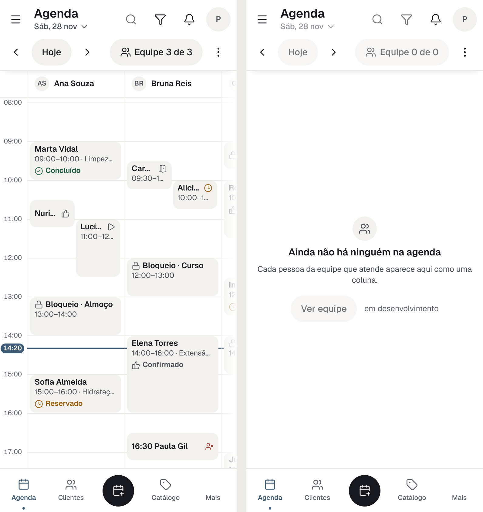
- **B** `user-group` (três pessoas, uma à frente): continua "bonequinhos" e não se confunde com Clientes: 
- **Recomendo B:** um ícone por coisa (`DESIGN.md` §5; Nielsen 4, consistência); com A, "Equipe 3 de 3" e "Clientes" ficam com o mesmo desenho na mesma tela. Descartados: `users-round` (quase igual a `users`), `contact-round` e `square-user-round` (parecem ficha de cliente). Desfaz-se trocando uma linha do `DESIGN.md` §5.

## Assumption à vista (confirmar no pedido de merge)
- **A profissional não vê o botão "Equipe N de M"** (Assumption 6 da spec; leitura da E60·4): ela só tem a própria
  coluna, e um botão sem escolha só confunde. Está assim nas imagens `agenda-dia-profissional` e no `DESIGN.md` §6,
  marcado "a confirmar pelo dono no pedido de merge".

## Para outros papéis (não toco nos arquivos deles)
- **Arquiteto de software:** a grade da E59·A precisa do primeiro e do último item do dia e da hora atual (D17); nada
  novo no banco.
- **Revisor de design:** v4 e o `DESIGN.md` atualizado para revisar (imagens regeradas todas; novas: `agenda-adicionar-aberto`,
  `agenda-grade-alarga-agora`; saíram `agenda-novo-aberto` e `alternativa-e59-b-24h`).

## Não verificado
- **Revisor de design:** a v4 e as mudanças no `DESIGN.md` não foram revistas; as 3 correções da 3ª rodada também não foram reconferidas por ele.
- **Ícone do Equipe (E63):** nenhuma das duas opções foi testada com quem usa.
- **Botão só ícone da barra:** não testado se quem usa entende que abre "Adicionar" sem o nome escrito.
- **Acessibilidade:** o axe (wcag2a, wcag2aa, wcag21a, wcag21aa, wcag22aa) deu 0 violações nas 57 capturas da v4 do
  protótipo; não vale para o app real. Não testei com leitor de tela, nem a ordem do Tab, nem o ponto "horário vazio"
  com setas, nem zoom de 200 % na rolagem lateral (WCAG 1.4.10). No protótipo, o Fim fechado aponta `aria-controls`
  para uma lista que não existe na página (só a do Início foi desenhada aberta).
- **Contraste:** branco sobre `--id` e `--id` sobre branco calculados à mão (7,0:1); não medidos na imagem.
- **Imagens estáticas:** menus, folhas e listas desenhados abertos no lugar, sem clique; o "agora" é fixo (14:20 e
  21:40); a rolagem da grade alargada até a hora atual foi simulada deslocando a grade.
- **Folha do bloqueio no 390:** com os atalhos em duas linhas, a folha chega ao topo da grade; em telas menores que 844
  de altura ela precisa rolar por dentro (não desenhado).
- **Barra de baixo nas outras telas:** o botão só ícone só foi desenhado na Agenda.
- **Dados:** dia e pessoas fictícios; cartões de agendamento só existem depois da spec do Agendamento.
- **Textos em es e en:** não escritos aqui (arquivos de idioma, na construção).
