# Ficha visual · Agenda (E55)

- **Spec:** `spec.md` (§3, §4, RF-01 a RF-11, RN-04 a RN-06, RN-08) · **Plano:** `plan.md` §3.1 (L-2, L-3, L-4), §5.6 e §7
  · **Tarefa:** P3
- **Escrito por:** Designer de produto · **Norma:** WCAG 2.2, Material Design, Apple HIG · **Fonte:** só o `DESIGN.md`;
  base visual: canvas do dono `docs/design/canvas/N8AgendaPc` e `N8AgendaCel` (pedido (c)), sem as cores e peças que
  o `DESIGN.md` não tem (vermelho da linha do "agora", "€ previstos", busca na Agenda, faixa da semana)
- **Conferência:** Revisor de design (P4), pendente. **"Sim" do dono:** pendente.
- **Protótipo:** HTML estático fora do repositório, com o `tokens.css`, o `base.css` e o CSS das peças do item 4
  (`botao`, `contador`, `campos`, `etiqueta-status`, `camadas`, `estados`, `estrutura`, `sua-conta`); fonte Geist;
  ícones Lucide. Capturas com Playwright (Chromium), 390 × 844 e 1440 × 900, escala 2×. Peças novas (L-3) desenhadas só
  com `var(--...)`. Dados fictícios: equipe Ana Souza (dona), Bruna Reis, Carla Lima; dia sábado, 28 nov 2026.

---

**E55 · Tela Agenda** (fala o Designer de produto · norma WCAG 2.2; Revisor de design: pendente)

**Antes:** a Agenda não existe; `/` mostra a tela inicial (só a barra com Sua conta, E47·3·A).

| Antes | Celular (390) | Computador (1440) |
|---|---|---|
| Tela inicial de hoje | 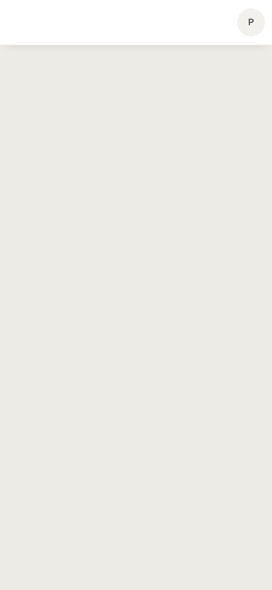 | 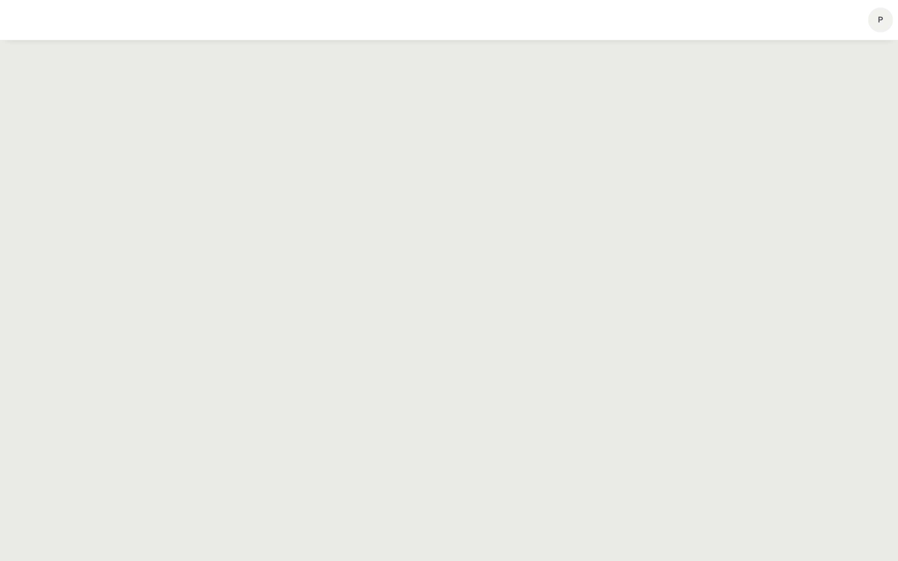 |

**Depois:**

| Estado | Celular (390) | Computador (1440) |
|---|---|---|
| Dia, dona ou recepção (vê todas as colunas) | 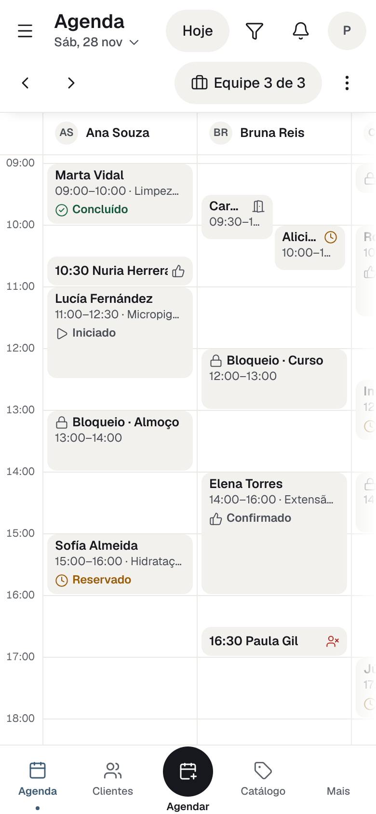 | 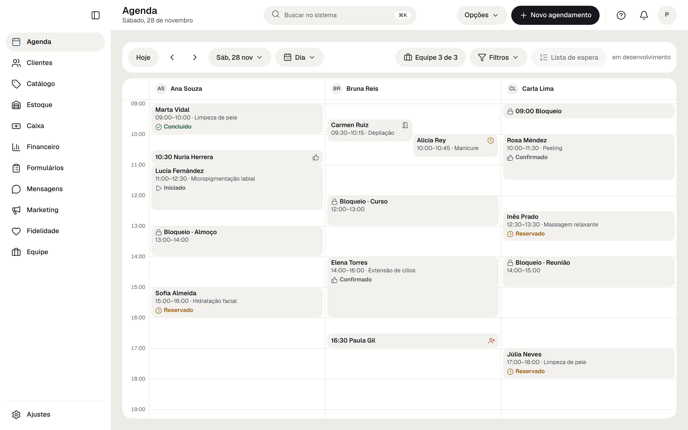 |
| Dia, profissional (a própria coluna completa, primeiro; as outras só "Ocupado") |  |  |
| Dia na v1, antes do Agendamento (só bloqueios; "Novo agendamento" em desenvolvimento) |  |  |
| Vazio |  |  |
| Carregando | 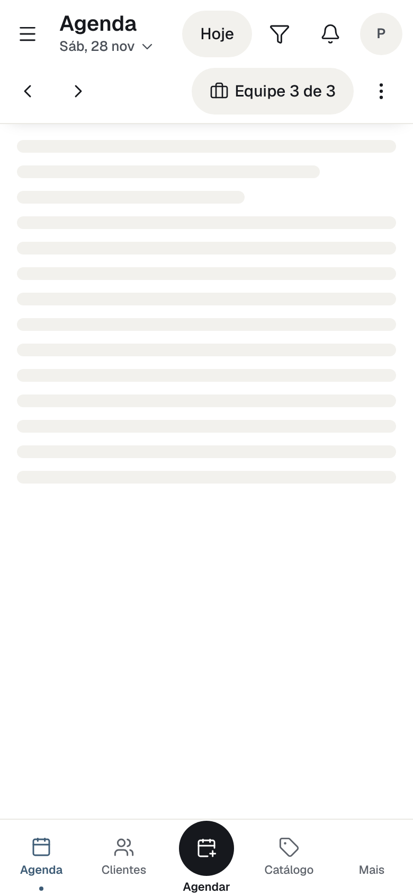 | 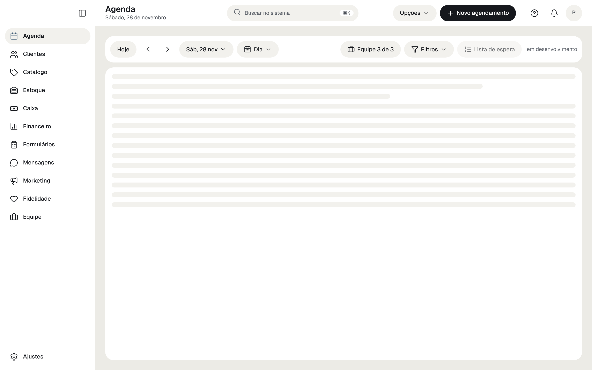 |
| Erro | 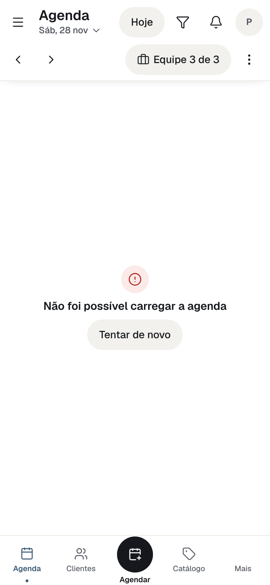 |  |
| Sem resultado (filtro esconde tudo) |  | 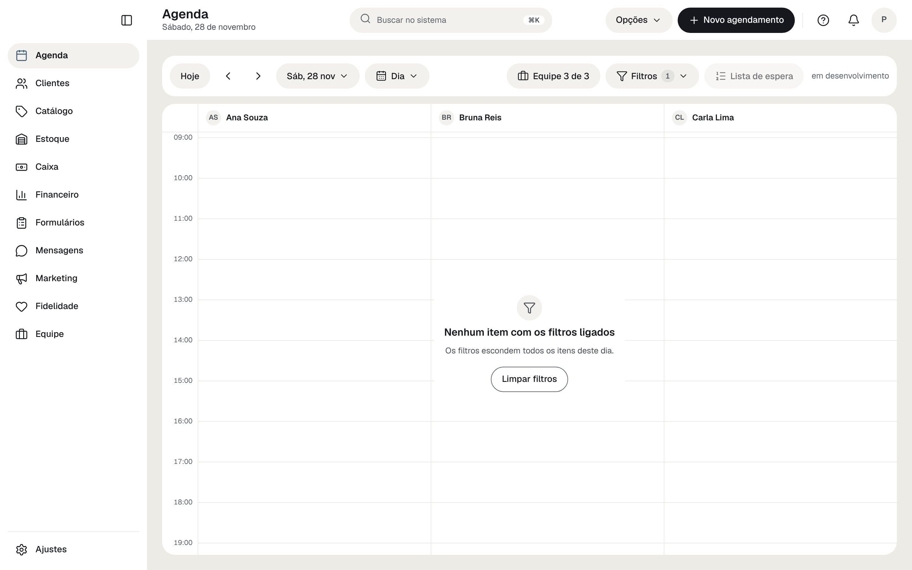 |
| Sem profissional |  |  |
| Passou do teto de itens (RN-08) | 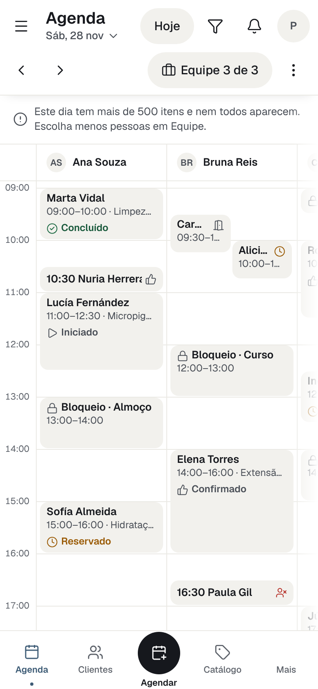 |  |
| Opções aberto: "Bloquear horário" (E55·4) |  | 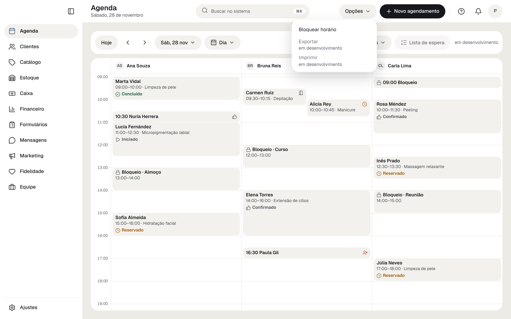 |
| Modo de ver (☰ no celular, "Dia ▾" no computador) | 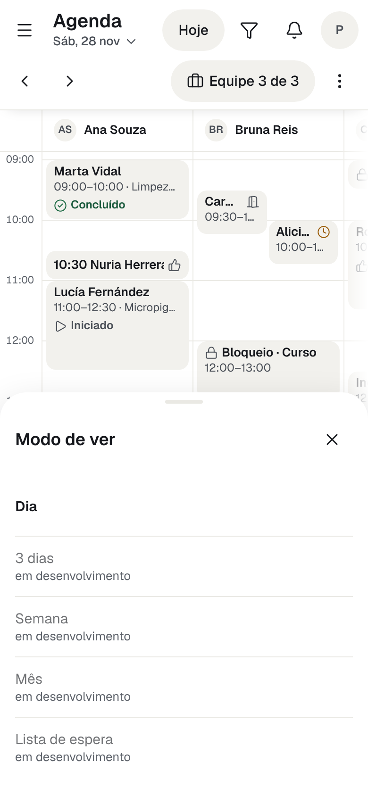 | 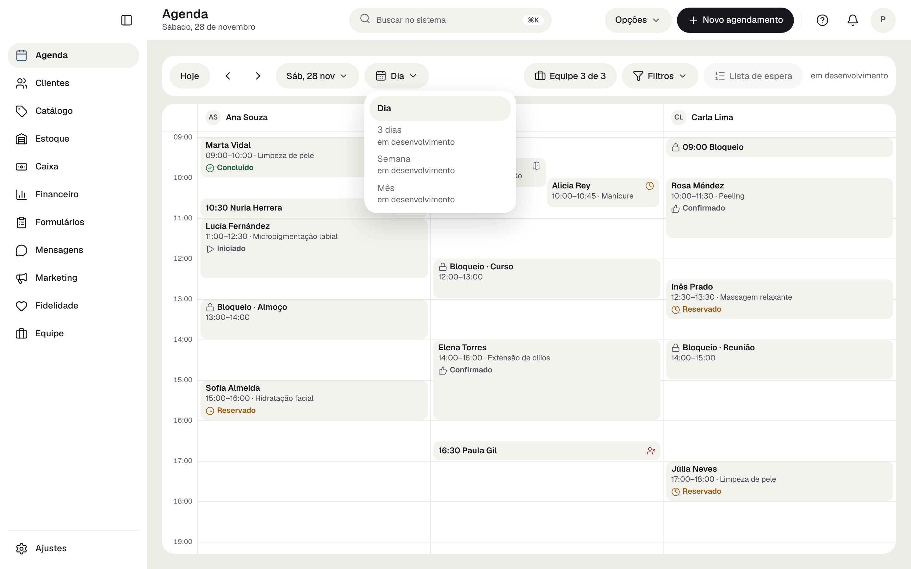 |
| Equipe 2 de 3 |  |  |
| Filtros (Cancelado desligado por padrão, RN-06) |  |  |
| Bloqueio · criar (dona/recepção) |  |  |
| Bloqueio · criar (profissional: campo só com ela, só leitura) |  |  |
| Bloqueio · editar, com ⋮ aberto (Excluir) |  |  |
| Bloqueio · conflito recusado (RN-04) |  |  |
| Bloqueio · excluir, janelinha |  | 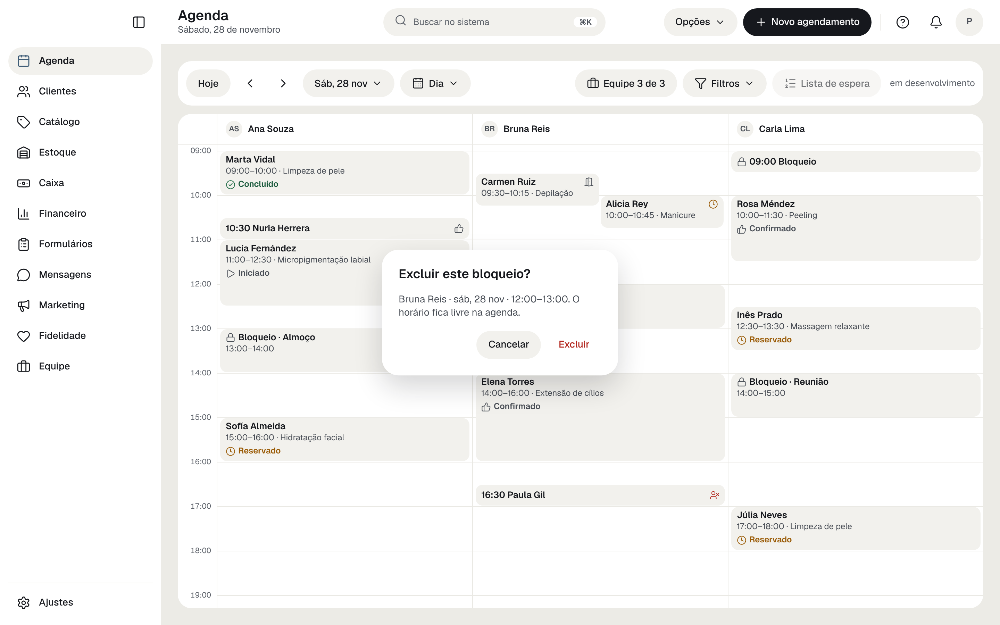 |
| Bloqueio · excluído, aviso com "Desfazer" |  | 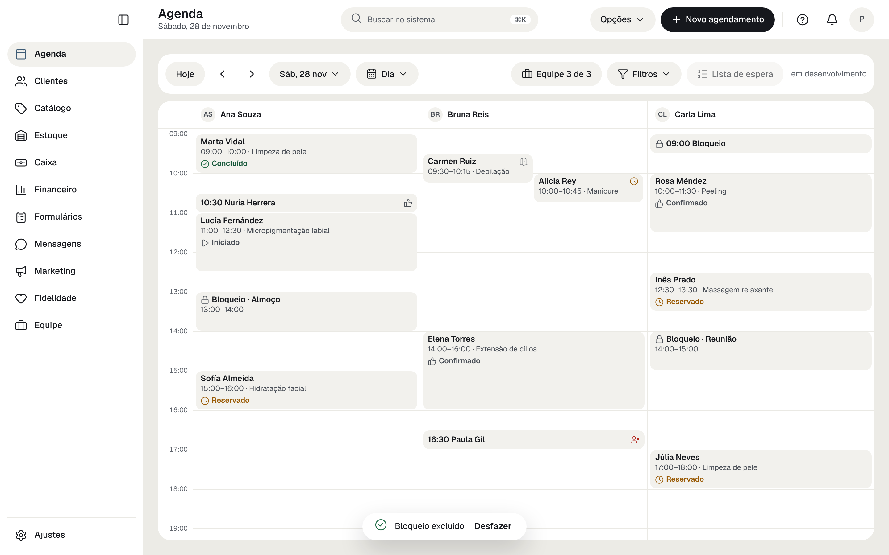 |

## Comportamento (para quem constrói e para o e2e)
- **Uma peça preta:** "Novo agendamento" (computador) e "Agendar" (celular). Na v1, sem o Agendamento (RF-08):
  "Novo agendamento" esmaecido com "em desenvolvimento" ao lado; o Agendar da barra e o toque no cartão abrem um aviso
  "em desenvolvimento" (no 390 não cabe a nota ao lado). Painel e folha abertos têm o próprio preto (Salvar, Mostrar N
  itens), e a tela de trás não conta (`DESIGN.md` §8b).
- **Computador:** barra do topo (título, data por extenso, busca geral, Opções ▾, Novo agendamento, ajuda,
  Notificações, Sua conta); barra da grade num bloco branco: Hoje · ‹ › · data em pílula ▾ (abre o calendário) ·
  Dia ▾ · (à direita) Equipe N de M · Filtros ▾ · Lista de espera (em desenvolvimento). Sua conta passa a ficar na barra
  do topo (muda `sua-conta.tsx`, previsto no plano §5.6).
- **Celular:** cabeçalho com ☰ (Modo de ver), "Agenda" e a data embaixo como botão ▾ (abre o calendário), Hoje, funil,
  sininho e Sua conta; embaixo, na mesma faixa branca, ‹ › · Equipe N de M · ⋮ (Opções). Lista de espera fica na folha
  do ☰, em desenvolvimento. Duas colunas de 160 à vista; as outras rolam para o lado, com esmaecido na ponta (o mesmo
  do seletor, §5); o cabeçalho das colunas rola junto.
- **Colunas:** ordem fixa da equipe; para quem tem `agenda.ver` "próprios", a própria coluna vem primeiro.
  Cabeçalho: bolinha 24 com as iniciais e o nome (vem da E55·1).
- **Cartões:** o agendamento e o bloqueio são botões (abrem o agendamento ou o bloqueio); "Ocupado" não é botão, não
  recebe foco por toque, só é lido ("Ocupado, 10:30 a 11:00"). Filtros não agem nas colunas "Ocupado" (CA-13); para a
  profissional, o painel de Filtros diz numa linha "Os filtros valem só para a sua coluna."
- **Tamanhos do cartão** (hora = 64 px): de 1 h ou mais: nome, "início–fim · serviço" e o status com ícone e palavra;
  de 45 min: nome e ícone do status, e a hora com serviço; menos de 45 min: uma linha "hora + nome" e o ícone; o nome
  do status, o fim e o serviço vão para o leitor de tela (`DESIGN.md` §5: no cartão pequeno, só o ícone).
- **Lado a lado (RN-05):** itens que se cruzam dividem a coluna (Carmen Ruiz e Alicia Rey).
- **Teclado (RNF-03):** cada coluna é um grupo com o nome da pessoa; Tab percorre os cartões por coluna e por hora;
  Enter abre. O nome acessível começa pelo texto visível (WCAG 2.5.3).
- **Bloqueio:** painel 480 à direita (computador) e folha de baixo (celular), título "Bloqueio de horário" (nome do
  status no §5). Campos: Profissional*, Data*, Início*, Fim* (seleção ▾ em passos de 15 min, a peça `CampoSelecao` que
  já existe), Motivo (várias linhas, até 200). Com alcance "próprios", Profissional fica só leitura com a própria
  pessoa. Ao editar, ⋮ (Opções) no topo do painel com Excluir em vermelho → janelinha → aviso "Bloqueio excluído" com
  "Desfazer". Salvar fecha e mostra o aviso "Bloqueio salvo".
- **Erros do bloqueio:** conflito (RN-04) numa linha acima de Salvar, com ícone, `role="alert"`, sem contorno vermelho
  (não se diz qual item conflita). Fim antes do início ou menos de 5 min (RN-03): erro no campo Fim, com contorno
  vermelho e frase embaixo. Desfazer que bate em horário ocupado: aviso "Não foi possível desfazer: o horário já foi
  ocupado."
- **Estados:** carregando com as linhas cinza do §8 no lugar da grade, depois de 0,3 s, anunciado "Carregando a agenda";
  vazio com a grade à vista e o estado no meio; sem resultado com "Limpar filtros"; sem profissional com Hoje, Equipe e
  Filtros desativados e "Ver equipe" em desenvolvimento; erro com "Tentar de novo"; teto como linha acima da grade
  (`role="status"`).

## Onde uma ideia E54 mudaria a tela (o dono ainda não respondeu; as imagens estão **sem** elas)
- **E54·1:** tocar ou dar Enter num horário vazio abriria um menu com "Novo agendamento" e "Bloquear horário", já com a
  hora e a pessoa; seria a 2ª entrada do bloqueio, além de Opções.
- **E54·2:** uma linha de 2 px atravessaria a coluna de hoje na hora atual, com a hora na coluna das horas; a cor
  precisa entrar no `DESIGN.md` (o vermelho do canvas é erro).
- **E54·3:** abaixo do Motivo, chips "Almoço · Folga · Reunião · Curso · Pessoal" que preenchem o campo.
- **E54·4:** o painel nasceria com Fim = Início + 1 h e o Fim andaria junto quando o Início passa dele.
- **E54·5:** Início e Fim virariam campos de digitar ("1410" → 14:10), em vez da seleção ▾.
- **E54·6:** embaixo do nome no cabeçalho da coluna, "3 atendimentos · 4 h 50 min" em 12 `--ink3` (só na coluna
  completa).
- **E54·7:** o calendário da data marcaria com um ponto os dias que têm itens.
- **E54·8:** a folha do ☰ ganharia "Lista" ativa no celular, com os itens em ordem e "Livre 14:30–16:00" entre eles.

## Nomes e peças novos (fora do `DESIGN.md`; entram nele com a E55·3)
**Peças:**
1. **Grade do dia:** coluna das horas 56 (computador) e 44 (celular), hora 11 `--ink3`, 64 px por hora, linha da hora
   e das colunas em `--line`, sobre a superfície `--card`.
2. **Cabeçalho da coluna:** 44 de altura, bolinha 24 (`--btn`, iniciais `--ink2`, a mesma da cliente na tabela) e nome
   13 forte. A bolinha da cliente passa a servir também à pessoa da equipe.
3. **Cartão do agendamento e do bloqueio:** botão em `--btn` (é controle sobre superfície), **canto 10** (hoje só o
   quadrado da inicial), três tamanhos (acima). Bloqueio: ícone `lock` e "Bloqueio · motivo".
4. **"Ocupado":** área em `--page` (o fundo aparece como "fora do seu alcance"), canto 10, "Ocupado" 12 forte `--ink2`
   e o horário 12 `--ink3`; sem ícone, sem toque, sem ⋮. Uso novo do `--page` dentro de um bloco.
5. **Celular:** data como botão ▾ no subtítulo do cabeçalho; faixa da grade (‹ › · Equipe · ⋮) colada ao cabeçalho;
   rolagem lateral das colunas com esmaecido na ponta.
6. **Equipe N de M:** menu aberto (computador) e folha (celular) com caixinhas, aplicando na hora.
7. **Linha de aviso no topo da grade** (teto, RN-08): ícone `circle-alert` e frase 13 `--ink2`.
8. **Ícones novos:** `menu` (☰, o §5 cita o ☰ sem nome de ícone) e `list-ordered` (Lista de espera, que o §5 manda
   ter ícone e nome).

**Nomes:** Ocupado · Bloqueio · Bloquear horário · Bloqueio de horário (título; já é nome de status) · Profissional ·
Data · Início · Fim · Motivo · "Exemplo: almoço" · Bloqueio salvo · Bloqueio excluído · "Excluir este bloqueio?" · "O
horário fica livre na agenda." · Exportar · Imprimir · Modo de ver · Dia · 3 dias · Semana · Mês · Equipe (título da
folha) · Status · Bloqueios · Mostrar bloqueios · Mostrar N itens · Dia anterior · Dia seguinte · "escolher data"
(leitor) · "Ainda não há agendamentos neste dia" · "Marque um agendamento ou bloqueie um horário." · "Nenhum item com
os filtros ligados" · "Os filtros escondem todos os itens deste dia." · "Ainda não há ninguém na agenda" · "Cada pessoa
da equipe que atende aparece aqui como uma coluna." · Ver equipe · "Não foi possível carregar a agenda" · "Carregando a
agenda" (leitor) · "Este dia tem mais de 500 itens e nem todos aparecem. Escolha menos pessoas em Equipe." · "Já há um
bloqueio ou agendamento neste horário. Escolha outro horário." · "O fim tem de ser depois do início." · "O bloqueio
tem de ter pelo menos 5 minutos." · "Não foi possível desfazer: o horário já foi ocupado." · "Os filtros valem só para
a sua coluna." Nenhum texto diz "estúdio" (E47).

## Decisões para o dono

### E55·1 · De onde vem o nome no topo de cada coluna (L-2; dado pessoal da equipe)
Hoje o sistema não guarda nome da pessoa, só o e-mail.
- **E55·1·A:** um campo novo, **"nome de exibição"**, só para isto: as colegas veem só esse nome e as iniciais. Na v1
  não há tela para editar (é do módulo Equipe); em desenvolvimento os nomes são fictícios, postos pelo preparo de teste.
- **E55·1·B:** usar o começo do e-mail (antes do @) → sem campo novo, mas mostra às colegas parte do e-mail, que muitas
  vezes é o nome completo ou um apelido pessoal.
- **E55·1·C:** "Profissional 1, 2, 3" até existir a Equipe → nenhum dado pessoal, mas a recepção não sabe quem é quem.
- **Recomendo A:** mostra só o necessário (RGPD art. 5(1)(c), minimização) e fala a língua de quem usa (Nielsen 2).

### E55·2 · O endereço inicial (`/`) abre a Agenda (L-4)
- **E55·2·A:** com a Agenda pronta, entrar no sistema leva direto à Agenda; a "tela inicial" vazia sai do `DESIGN.md`.
- **E55·2·B:** fica a tela inicial vazia; a pessoa toca em Agenda no menu.
- **Recomendo A:** o `DESIGN.md` §8b já diz que a tela inicial vale "até a Agenda existir", e a Agenda é o uso do
  balcão (menos um toque; Nielsen 7, eficiência).

### E55·3 · Peças e nomes novos da Agenda (L-3), como nas imagens
- **E55·3·A:** aceitar todos da lista acima, com o celular em 2 colunas à vista e as outras rolando para o lado → entram
  no `DESIGN.md` §4, §5, §6 e §8b e nos arquivos de idioma.
- **E55·3·B:** igual, mas no celular **uma coluna por vez**, trocada pelo Equipe → mais largura por cartão, menos visão
  do dia.
- **E55·3·C:** aceitar e trocar algum → diga qual e o novo.
- **Recomendo A:** 2 colunas de 160 cabem o nome e a hora sem cortar o essencial, e a rolagem com esmaecido já existe no
  seletor (§5); é o que o canvas do dono desenhou (N8). "Ocupado" sem ícone cumpre a E26·1·B ("só como ocupado") e o
  fundo `--page` diz "não é seu" sem cor de estado.

### E55·4 · Por onde se cria um bloqueio
- **E55·4·A:** "Bloquear horário" dentro de **Opções** (Opções ▾ no computador, ⋮ no celular); tocar num bloqueio abre
  para editar.
- **E55·4·B:** botão claro "Bloquear horário" na barra da grade (computador) e no ⋮ (celular) → fica mais à vista, mas
  disputa o olho com "Novo agendamento" (§1, "uma delas está no nível errado").
- **E55·4·C:** só tocando num horário vazio → depende da E54·1·A; sem ela, não haveria como criar.
- **Recomendo A:** o §5 manda ações secundárias da tela para Opções; com E54·1·A, o horário vazio vira um atalho a mais.

**Desfaz-se assim:** mudar a linha no `DESIGN.md` e o texto no arquivo de idioma; a tela lê dali. E55·1 desfaz-se com
uma migration que tira o campo. E55·2 desfaz-se voltando a rota `/` à tela inicial.
**Responda:** os códigos, por exemplo "E55·1·A E55·2·A E55·3·A E55·4·A". Com o "sim", o Designer grava as peças e
os nomes no `DESIGN.md`.

## Não verificado
- **Revisor de design:** ainda não conferiu (P4).
- **Acessibilidade:** axe (wcag2a, wcag2aa, wcag21a, wcag21aa, wcag22aa) deu 0 violações nas 40 capturas do protótipo;
  não é o app real. Não testei com leitor de tela de verdade nem a ordem do Tab na grade. A rolagem lateral no celular
  e o esmaecido não foram testados com zoom de 200 % (WCAG 1.4.10).
- **Contraste:** não medi `--ink3` (hora 11 e horário do "Ocupado") sobre `--page` nem `--warn` sobre `--btn`; o
  `DESIGN.md` §3 diz que todo texto passa de 4,5:1 sobre fundo, superfície e trilho, mas não citei o caso do cartão.
  Os textos esmaecidos (60 %) ficam abaixo de 4,5:1 (a WCAG isenta controle desativado).
- **Imagens estáticas:** menus e camadas abertos foram desenhados no lugar, sem clique; o protótipo põe um
  `text-decoration: none` nos links do menu principal e da barra de baixo, que o CSS do item 4 não tem (no app real os
  links podem aparecer sublinhados: o Engenheiro de software confere).
- **Celular:** o cartão de uma linha corta o nome sem reticências em alguns casos ("10:30 Nuria Herrera"); a barra de
  baixo segue o código ("Mais" sem ícone, E25·2 em aberto).
- **Dados:** dia e pessoas fictícios; a grade das imagens vai de 09:00 a 18:00/19:00, mas a real tem 24 h com rolagem
  (Assumption 1 da spec). Cartões de agendamento só aparecem depois da spec do Agendamento.
- **Textos em es e en:** não escritos aqui (arquivos de idioma, na construção).
- **Códigos:** E55 estava livre na `feat/agenda` em 28/11; outras branches podem usar o mesmo número (o Gerente de
  projeto confere antes de mandar).
