# Ficha visual · Agenda (versão 3: respostas E54, E55, E57 e E58)

- **Spec:** `spec.md` (§3, §4, RF-01 a RF-15, RF-21, RF-22, RN-03 a RN-10, CA-05, CA-13, CA-15, CA-16; respostas na
  §16 e na §17) · **Plano:** `plan.md` (não tocado nesta versão) · **Tarefa:** P3
- **Escrito por:** Designer de produto · **Norma:** WCAG 2.2, Material Design, Apple HIG · **Fonte:** só o `DESIGN.md`
  e a lista de peças novas abaixo (entram no `DESIGN.md` com o "sim" do dono)
- **Inspiração:** referência do dono (capturas de outro sistema no celular, enviadas em 28/11; **nenhuma imagem dele
  entra no repositório** e nada foi copiado). Ideia aproveitada: o botão do meio da barra de baixo abre as opções de
  criar. Formatos de visão, escala de tempo e configuração dos cartões ficam para a spec seguinte (E57·B).
- **Conferência:** Revisor de design: versão 2 liberada com ressalvas; **esta versão 3 ainda não foi revisada**.
  **"Sim" do dono:** pendente (E59 e E60).
- **Protótipo:** HTML estático fora do repositório, com o CSS real do item 4; fonte Geist; ícones Lucide; capturas com
  Playwright (Chromium), 390 × 844 e 1440 × 900, escala 2×. Dados fictícios: equipe Ana Souza (dona), Bruna Reis,
  Carla Lima; sábado, 28 nov 2026; "agora" = 14:20.

---

## Mensagem ao dono (molde "Ficha visual")

**E59 e E60 · Agenda, versão 3** (fala o Designer de produto · norma WCAG 2.2, Material Design, Apple HIG; o Revisor de
design confere antes de mandar)
- **O que é:** a Agenda com as suas respostas: "+ Novo" no lugar do "Novo agendamento", nome de exibição nas colunas, a
  profissional só com a coluna dela, toque no horário vazio, linha do agora, bloqueio com 1 h, horário só por lista e
  atalhos de motivo. Tela principal: `ficha/agenda-dia-dona-390.png` e `-1440.png`.
- **E59 · Quanto da grade aparece:** **A** de 08:00 às 20:00, que se alarga sozinha quando há algo fora
  (`agenda-dia-dona`; alargada: `agenda-grade-alarga`, com um bloqueio às 06:30) · **B** o dia inteiro (24 h), abrindo
  rolada perto da hora atual (`alternativa-e59-b-24h`). **Recomendo A:** a manhã do dia de trabalho fica à vista ao
  abrir, sem espaço vazio de madrugada, e nada some (o que estiver fora alarga a grade). Desfaz-se trocando uma regra
  na tela, sem banco.
- **E60 · O que eu decidi no desenho (confirme ou troque):** (1) "Bloquear horário" fica **dentro do "+ Novo"** e no
  toque num horário vazio, sem botão separado e sem estar em Opções; (2) no celular, o botão preto do meio da barra de
  baixo **vira "Novo"** e abre as mesmas opções (`agenda-novo-aberto-390`); (3) a linha do agora é **azul ardósia**, a
  cor de "onde estou"; (4) a profissional não vê o botão "Equipe" (só há a coluna dela). **A** aceitar assim · **B**
  trocar algo (diga qual). **Recomendo A:** uma só peça preta por tela e o mesmo caminho no computador e no celular.
- **Desfaz-se assim:** cada item é uma linha no `DESIGN.md` e no arquivo de idioma.
- **Responda:** os códigos, por exemplo "E59·A E60·A".

---

## Imagens

| Antes | Celular (390) | Computador (1440) |
|---|---|---|
| Tela inicial de hoje |  |  |

| Depois · estado | Celular (390) | Computador (1440) |
|---|---|---|
| Dia, dona ou recepção (todas as colunas; linha do agora às 14:20; grade E59·A) |  |  |
| Dia, profissional (só a própria coluna; sem "Equipe"; E58·A) |  |  |
| "+ Novo" aberto, na v1 ("Novo agendamento" em desenvolvimento; "Bloquear horário" funciona) | 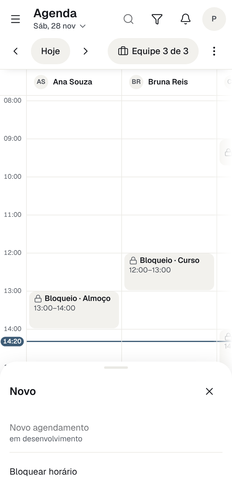 | 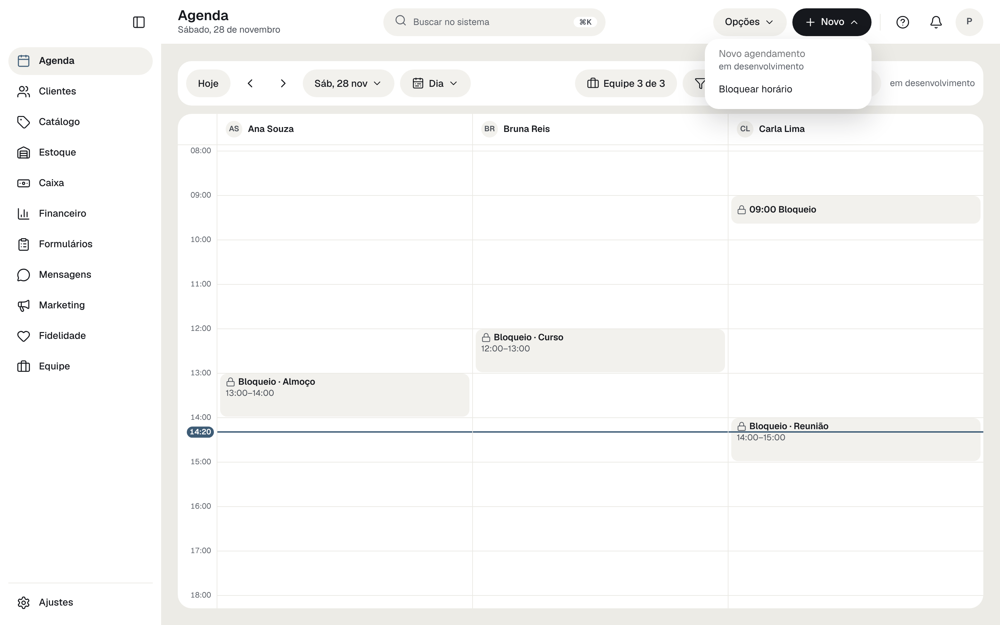 |
| Toque num horário vazio (marca 1 h e abre o menu com a hora e a pessoa; E54·1) | 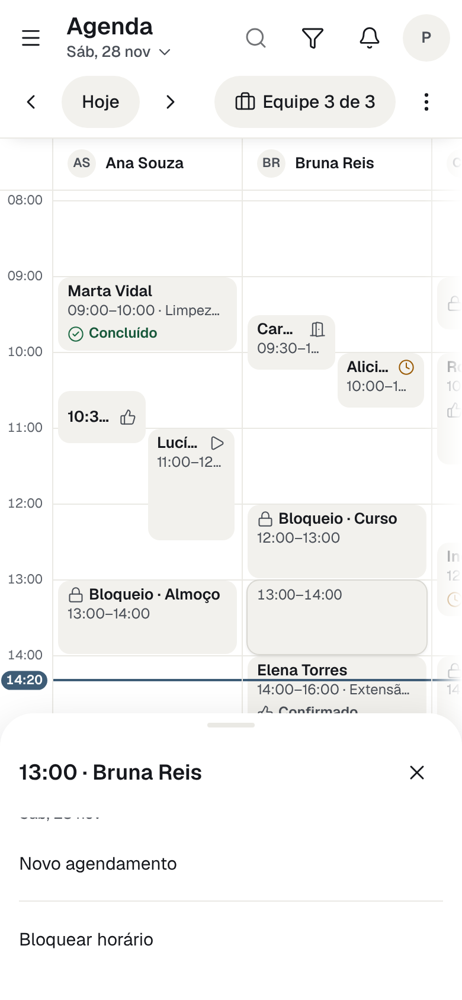 | 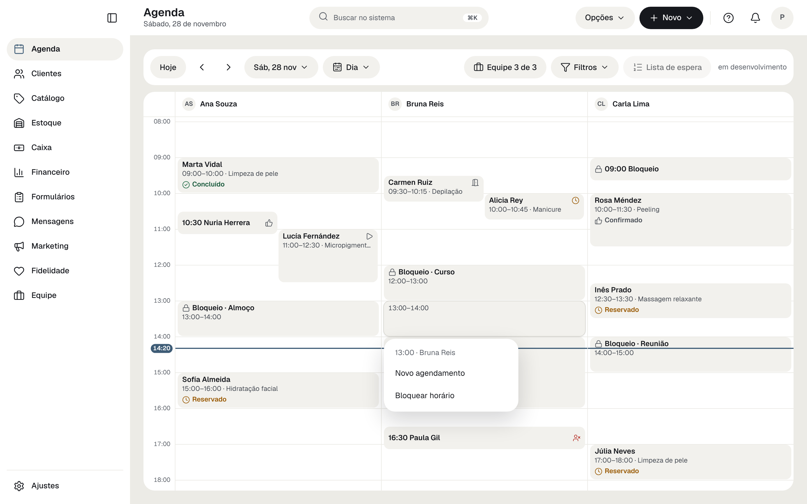 |
| E59·A, grade alargada (bloqueio às 06:30 abre a grade às 06:00) | 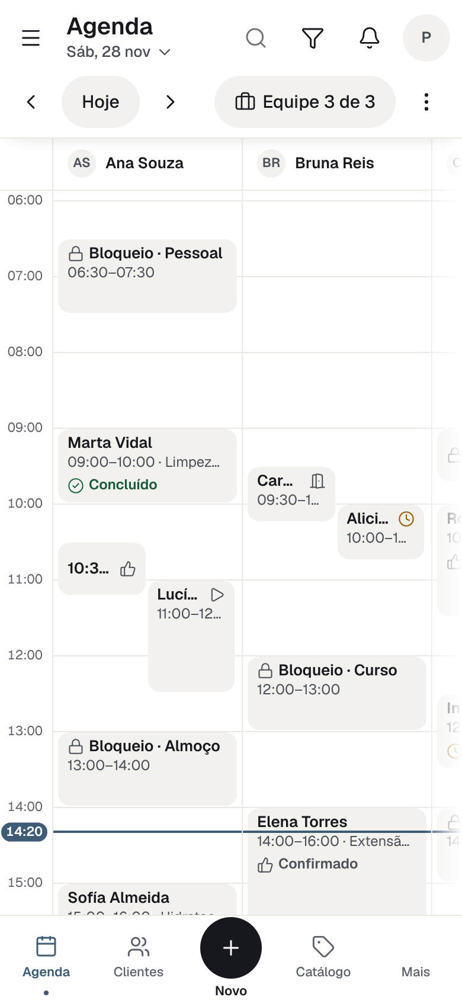 | 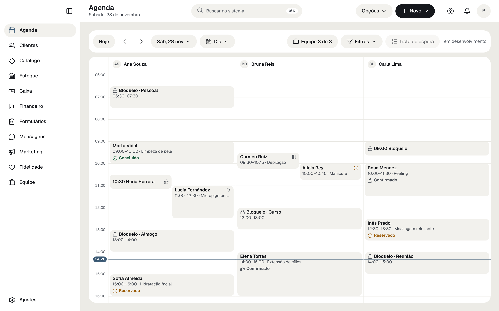 |
| Celular, pior caso: 3 itens que se cruzam e itens de 15 e de 5 min | 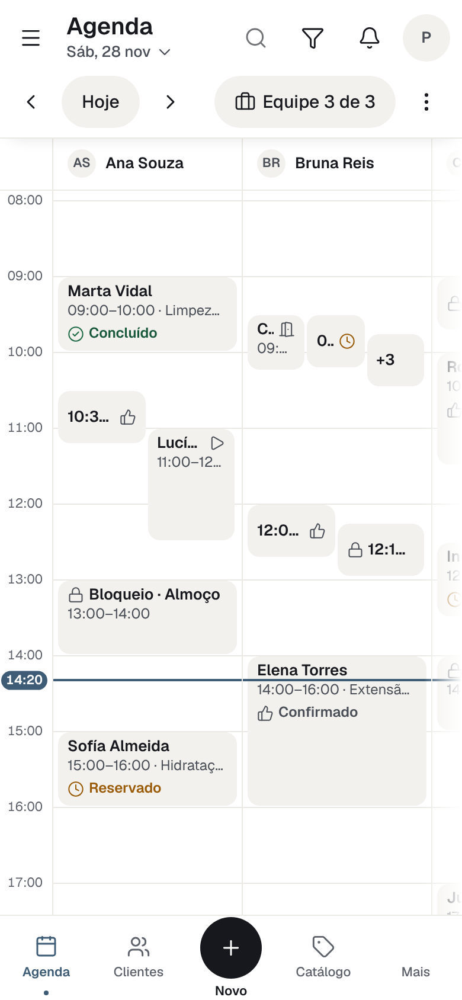 |  |
| Dia na v1, antes do Agendamento (só bloqueios) |  |  |
| Vazio na v1 ("Bloquear horário") |  |  |
| Vazio com o Agendamento ("Novo agendamento") | 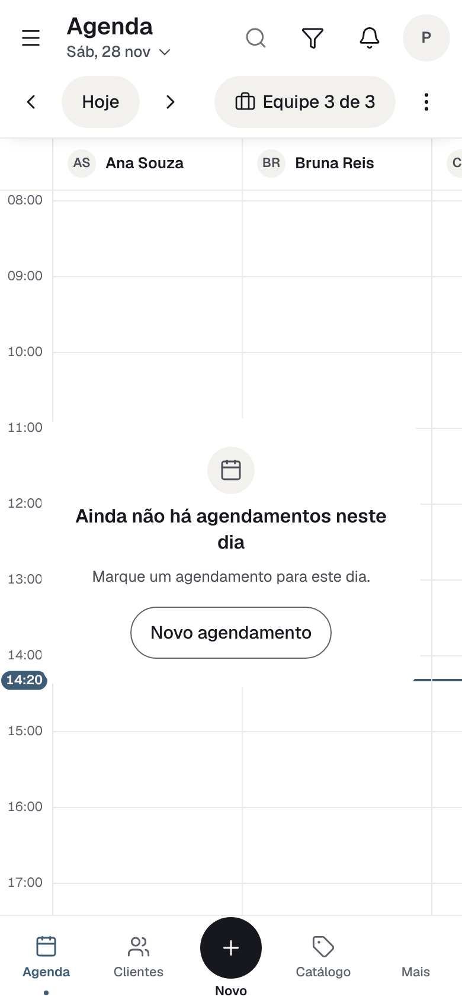 |  |
| Carregando |  |  |
| Erro |  |  |
| Sem resultado (filtro esconde tudo) |  |  |
| Sem profissional |  |  |
| Passou do teto de itens (RN-08) |  |  |
| Opções aberto (Exportar e Imprimir em desenvolvimento; sem "Bloquear horário") | 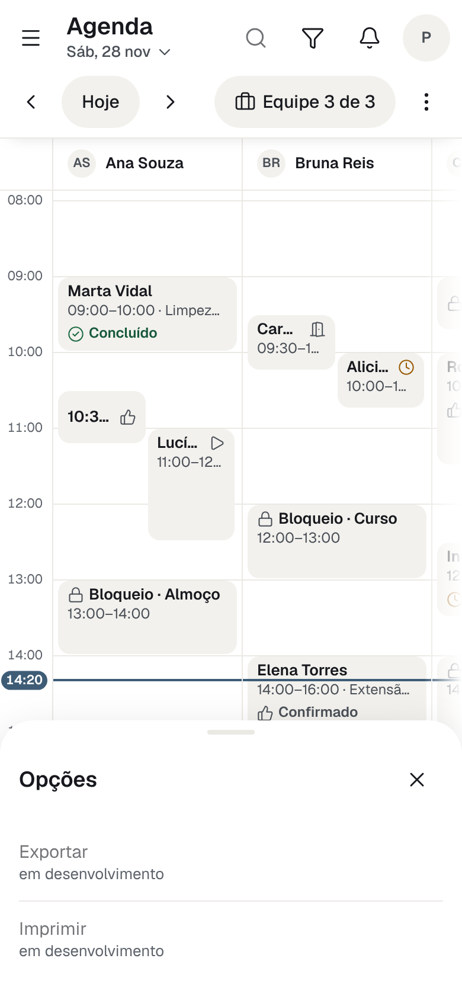 | 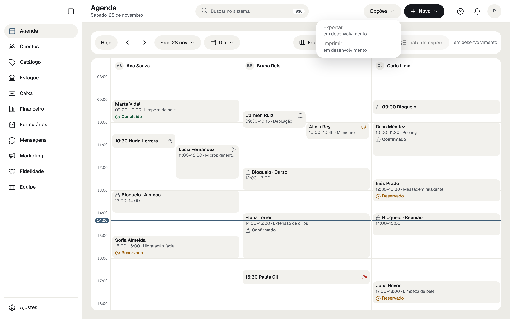 |
| Lupa do celular em desenvolvimento (aviso ao tocar; E57·B) |  | — (no computador há a busca geral) |
| Modo de ver (outros formatos em desenvolvimento; E57·B) |  |  |
| Equipe 2 de 3 |  |  |
| Filtros (Cancelado desligado por padrão, RN-06) |  |  |
| Bloqueio · criar a partir do horário vazio (13:00–14:00, nasce com 1 h; atalhos de motivo) |  |  |
| Bloqueio · lista de horários aberta (passo de 15 min, sem digitar; E54·5 trocada) | 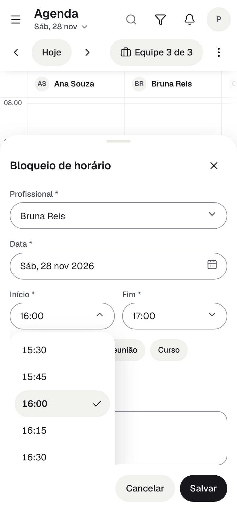 | 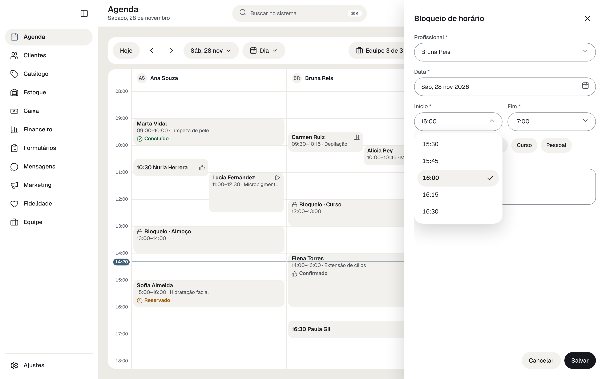 |
| Bloqueio · criar (profissional: campo só leitura) |  | 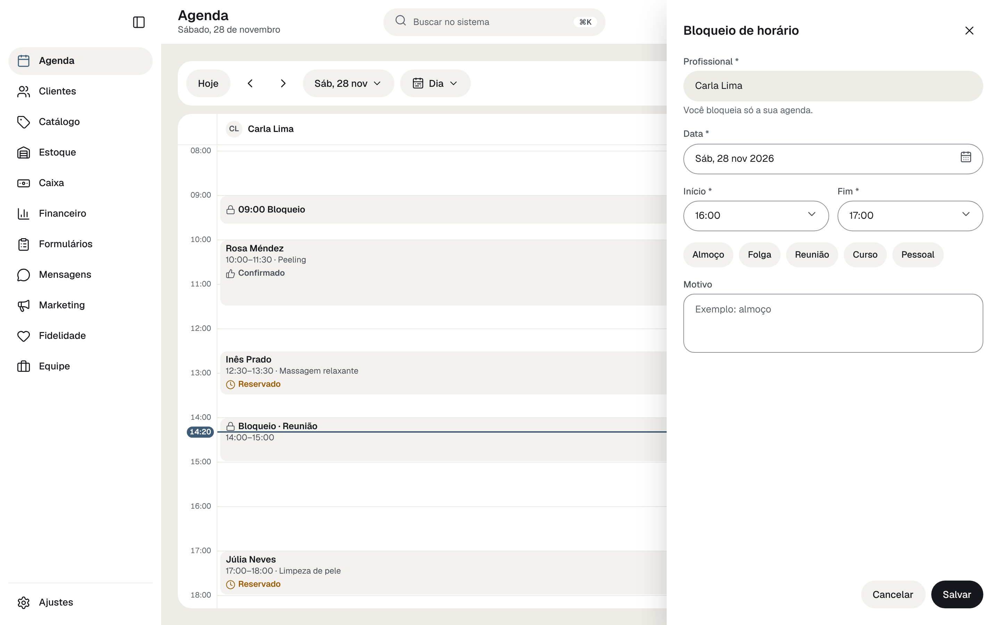 |
| Bloqueio · editar, com ⋮ aberto (Excluir) |  |  |
| Bloqueio · conflito recusado (RN-04) |  |  |
| Bloqueio · excluir, janelinha sobre o painel |  |  |
| Bloqueio · excluído, aviso com "Desfazer" |  |  |

| Alternativa (não recomendada) | Celular (390) | Computador (1440) |
|---|---|---|
| E59·B · 24 h, aberta rolada às 12:00 (a madrugada fica acima, vazia) | 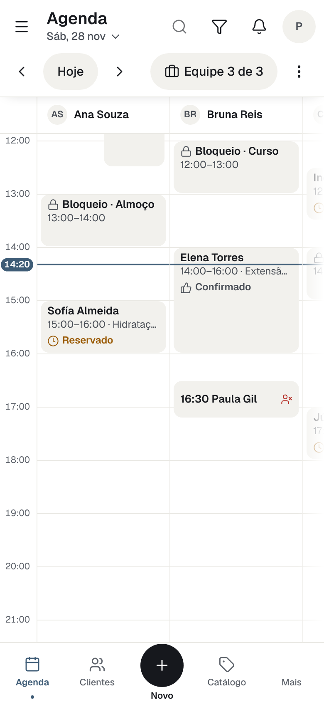 | 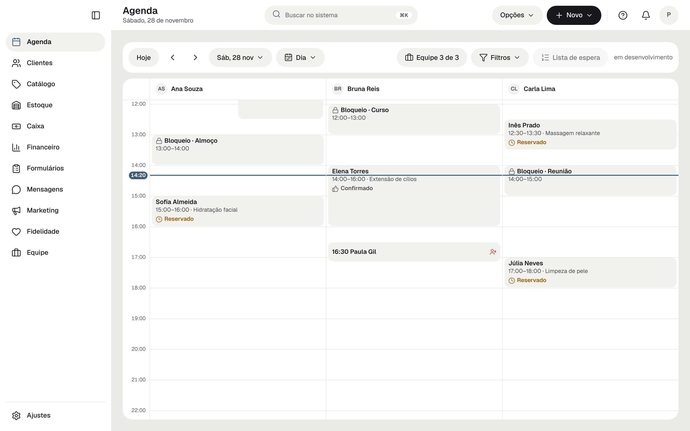 |

Saíram da ficha (respondidas ou sem efeito): as alternativas E55·1·B, E55·1·C, E55·3·B e E55·4·B;
`agenda-opcoes-bloquear` (virou `agenda-opcoes`); `agenda-filtros-profissional` (com a E58·A a profissional só tem a
própria coluna, e a frase "Os filtros valem só para a sua coluna." deixou de ter sentido).

## Decisões do Designer (E55·4 trocada e pontos que a spec deixou para a ficha)

1. **Bloqueio dentro do "+ Novo", sem botão separado nem configurador.** Entradas: "+ Novo" › "Bloquear horário", o
   toque num horário vazio (E54·1) e, no vazio da v1, "Bloquear horário" com contorno. **Motivo:** uma só peça preta
   por tela (`DESIGN.md` §1 e §5); um botão claro "Bloquear horário" ao lado disputava o olho (alternativa E55·4·B da
   versão 2); um configurador (escolher integrado ou separado por empresa) cria duas telas diferentes para ensinar e
   testar, contra a consistência (Nielsen 4) e o "menos é mais" (Nielsen 8). O toque no horário vazio já é o atalho
   rápido (Nielsen 7). Padrão de mercado: botão de criar que abre um menu curto (Material "menu" de botão; Apple HIG
   "pull-down button"). **"Bloquear horário" sai de Opções** (pedido do dono, E55·4 trocada).
2. **Celular: o "Agendar" da barra de baixo vira "Novo".** Mesmo lugar, mesmo círculo preto de 52, ícone `plus` no
   lugar do `calendar-plus`, nome "Novo"; abre a folha "Novo" com as mesmas opções do computador. **Motivo:** o
   computador e o celular passam a ter o mesmo caminho (Nielsen 4); manter "Agendar" no celular deixaria o bloqueio só
   no toque do horário vazio, escondido (Nielsen 6, reconhecer em vez de lembrar). **Custo:** marcar um agendamento no
   celular passa a ter um toque a mais (Novo › Novo agendamento). A barra de baixo é a mesma em todo o app; nas telas de
   outros módulos o "Novo" abre a mesma folha (o que mais entrar nela vem com pedido do dono, RF-08).
3. **Nome "Novo" com ▾.** O dono pediu "+ Novo"; o `DESIGN.md` §6 chama de "Adicionar ▾" o botão que cria mais de um
   tipo. Vale a ordem do dono só na Agenda; o ▾ (e `aria-haspopup="menu"`) diz que abre opções, como em "Opções ▾". O
   §6 ganha a linha "Novo ▾ · Agenda (computador) e botão do meio (celular)" e "Novo agendamento" passa a ser item do
   menu. **Risco registrado:** dois nomes para "criar com opções" (Novo ▾ na Agenda, Adicionar ▾ no Financeiro).
4. **Linha do agora em `--id` (azul ardósia).** 2 px na largura das colunas, por cima dos cartões, sem receber toque;
   na coluna das horas, a hora em pílula `--id` com texto branco 11 forte ("14:20"); o leitor de tela ouve "Agora,
   14:20". Só aparece quando o dia à vista é hoje; anda a cada minuto, sem animação. **Motivo:** o `--id` é "onde
   estou", e a linha diz onde se está no tempo; vermelho é erro, preto é ação (`DESIGN.md` §3). Contraste: branco sobre
   `--id` 7,0:1; linha sobre branco 7,0:1 (≥ 3:1, WCAG 1.4.11). Uso novo do `--id`: entra no §3 com o "sim".
5. **Profissional (E58·A): sem "Equipe".** Com uma coluna só, o botão não teria o que escolher; some, como manda a
   RF-11 (esconder o que não se usa). A coluna ocupa a largura toda nas duas larguras. Filtros continuam.
6. **Toque no horário vazio (E54·1):** o toque cai no quarto de hora tocado (arredonda para baixo) e marca **1 h** a
   partir dali, no desenho do escolhido do seletor (`--btn` com o anel `--selRing`), porque o bloqueio nasce com 1 h
   (E54·4) e a pessoa vê antes o que vai criar. Abre um menu (computador) ou uma folha (celular) com a hora e a pessoa
   no topo ("13:00 · Bruna Reis") e "Novo agendamento" · "Bloquear horário". Quem não pode gravar naquela coluna não vê
   o menu (RF-13). **Teclado:** cada coluna tem um ponto de Tab "horário vazio"; ↑ e ↓ andam de 15 em 15 min pelos
   horários livres; Enter abre o menu; Esc fecha e volta o foco (WCAG 2.1.1 e 2.4.3).
7. **"+ Novo" › "Bloquear horário" (sem hora tocada):** Data = o dia à vista; Início = o próximo quarto de hora depois
   de agora, se o dia é hoje, ou o início da grade (08:00 na E59·A), em outro dia; Fim = Início + 1 h (RN-10);
   Profissional vazio e obrigatório para dona e recepção (evita bloquear a pessoa errada), a própria para a
   profissional.
8. **Seletor de horário (E54·5 trocada, RN-09):** Início e Fim são botões de seleção (`role="combobox"` só de
   escolha) que abrem a lista dos horários de 15 em 15 min do dia, com o atual marcado (fundo `--btn`, forte e ✓) e
   rolado até ele; não há campo de digitar. O Fim mostra só horários depois do Início. Quando o Início passa do Fim, o
   Fim vira Início + 1 h e o leitor anuncia "Fim mudou para 17:00" (`aria-live`, WCAG 4.1.3).
9. **Atalhos de motivo (E54·3, RF-22):** acima do campo Motivo, cinco botões claros em pílula, 36 de altura com área de
   toque 44: Almoço · Folga · Reunião · Curso · Pessoal. Tocar **troca** o texto do Motivo pelo do atalho (não soma) e
   põe o foco no campo, que continua editável. Sem estado "ligado": o resultado está no próprio campo (Nielsen 1). No
   390 quebram em duas linhas, sem rolagem escondida.
10. **Opções:** funciona e abre Exportar e Imprimir, os dois "em desenvolvimento" (igual ao "Dia ▾"); no celular é o ⋮
    da faixa.
11. **Lupa do celular (E57·B):** no cabeçalho, antes do funil, esmaecida, mas tocável (`aria-disabled`, nome "Buscar
    na agenda, em desenvolvimento"); tocar mostra o aviso "A busca na Agenda está em desenvolvimento." (no 390 não cabe a
    nota ao lado). O `DESIGN.md` §5 já admite a lupa sozinha na Agenda do celular.

## Comportamento (para quem constrói e para o e2e)
- **Uma peça preta:** "+ Novo ▾" (computador) e "Novo" no meio da barra de baixo (celular), nas duas funcionando na v1
  (o bloqueio existe). Dentro, "Novo agendamento" fica "em desenvolvimento" até a spec do Agendamento (RF-08); o toque
  num cartão de agendamento também. Painel, folha e janelinha abertos têm o próprio preto (Salvar, Mostrar N itens), e
  a tela de trás não conta (`DESIGN.md` §8b).
- **Computador:** barra do topo (título, data por extenso, busca geral, Opções ▾, + Novo ▾, ajuda, Notificações, Sua
  conta); barra da grade num bloco branco: Hoje · ‹ › · data em pílula ▾ · Dia ▾ · (à direita) Equipe N de M ·
  Filtros ▾ · Lista de espera (em desenvolvimento).
- **Celular:** cabeçalho com ☰ (Modo de ver), "Agenda" e a data como botão ▾, lupa (em desenvolvimento), funil, sininho
  e Sua conta; faixa colada embaixo: ‹ Hoje › · Equipe N de M · ⋮ (Opções). Duas colunas de 160 à vista e as outras
  rolam para o lado, com esmaecido na ponta (E55·3·A).
- **Colunas:** ordem fixa da equipe; cabeçalho com a bolinha 24 das iniciais e o **nome de exibição** (E55·1·A,
  RF-21), nunca o e-mail. Profissional: só a própria coluna, sem "Equipe" (E58·A, RF-10, CA-13). **Nada de "Ocupado"
  nesta spec.**
- **Grade (E59, pendente):** na A, 08:00–20:00; se há item antes ou depois, a grade começa na hora cheia antes do
  primeiro e termina na hora cheia depois do último (nunca corta); abre em 08:00 se a hora atual cabe na primeira tela,
  senão rolada com a hora atual a um terço do alto. Na B, 00:00–24:00, aberta com a hora atual a um terço do alto. Nas
  duas, os dias de 23 h e 25 h seguem a RN-01.
- **Altura mínima e toque (WCAG 2.5.8):** 64 px por hora; o cartão nunca fica abaixo de 44 (celular) e 40
  (computador); quando a altura mínima cobre o seguinte, ficam lado a lado (RN-05); no máximo 3 lado a lado, e com 4 ou
  mais o 3º lugar vira o "+N" que abre a lista do horário.
- **Cartão estreito:** status só com o ícone (nome no leitor); nome e horário com reticências.
- **Conteúdo do cartão sozinho:** 1 h ou mais: nome, "início–fim · serviço" e status com ícone e palavra; 45 min: nome e
  ícone, e a hora com o serviço; menos de 45 min: "hora + nome" e o ícone.
- **Teclado (RNF-03):** cada coluna é um grupo com o nome da pessoa; Tab percorre os cartões por coluna e por hora e
  o ponto "horário vazio" (decisão 6); Enter abre.
- **Bloqueio:** painel 480 à direita (computador) e folha de baixo (celular), título "Bloqueio de horário". Campos:
  Profissional*, Data*, Início* e Fim* (lista de horários, decisão 8), atalhos (decisão 9) e Motivo (várias linhas, até
  200). Com alcance "próprios", Profissional só leitura com a frase "Você bloqueia só a sua agenda.". Ao editar, ⋮ com
  Excluir em vermelho → janelinha por cima do painel → aviso "Bloqueio excluído" com "Desfazer". Salvar fecha e mostra
  "Bloqueio salvo".
- **Erros do bloqueio:** conflito (RN-04) numa linha acima de Salvar, `role="alert"`; fim antes do início ou menos de 5
  min (RN-03): erro no Fim; com a lista sem digitação, o "fim antes do início" só aparece se o Início muda e o Fim não
  cabe no dia (RN-10: o Fim para no fim do dia e o leitor anuncia). Desfazer que bate em horário ocupado: "Não foi
  possível desfazer: o horário já foi ocupado."
- **Estados:** carregando (linhas cinza depois de 0,3 s, "Carregando a agenda"); vazio na v1 ("Ainda não há bloqueios
  neste dia" · "Bloquear horário" com contorno); vazio com o Agendamento ("Ainda não há agendamentos neste dia" · "Novo
  agendamento" com contorno); sem resultado com "Limpar filtros"; sem profissional com Hoje, Dia ▾, Equipe, Filtros e
  funil esmaecidos; erro com "Tentar de novo"; teto como linha acima da grade.

## Nomes e peças novos (fora do `DESIGN.md`; entram nele com o "sim" do dono)
**Peças e regras** (as 1 a 4 e 6 a 12 vêm da versão 2, já aceitas na E55·3·A; o "Ocupado" saiu pela E58·A):
1. Grade do dia: coluna das horas 56/44, hora 11 `--ink3`, 64 px por hora, linhas `--line` sobre `--card`.
2. Cabeçalho da coluna: 44, bolinha 24 e nome de exibição 13 forte.
3. Cartão do agendamento e do bloqueio em `--btn`, canto 10, três conteúdos por duração.
4. Altura mínima 44/40, lado a lado, no máximo 3, cartão "+N".
5. ~~"Ocupado"~~ (saiu: E58·A).
6. Celular: data como botão ▾; faixa ‹ Hoje › · Equipe · ⋮; rolagem lateral com esmaecido.
7. Equipe N de M em menu (computador) e folha (celular).
8. Linha de aviso do teto.
9. Campo só leitura.
10. Valor "6 de 7" na linha que abre.
11. Lista de espera dentro do ☰ no celular, em desenvolvimento.
12. Ícones `menu`, `list-ordered` e `calendar-range`.
13. **Novo nesta versão · "+ Novo ▾"** (decisões 1 a 3): ação principal preta que abre menu (computador) e folha
    (celular); no celular, o círculo do meio com `plus` e "Novo" substitui o "Agendar" em toda a barra.
14. **Linha do agora** em `--id` com a hora em pílula `--id` (decisão 4).
15. **Horário vazio escolhido:** 1 h em `--btn` com o anel do escolhido, e o menu com a hora e a pessoa (decisão 6).
16. **Lista de horários** do seletor: itens 44, atual com fundo `--btn`, forte e `check` (decisão 8). Ícone novo:
    `check`.
17. **Atalhos de motivo:** botões claros em pílula de 36 (toque 44), texto 13 (decisão 9).
18. **Lupa esmaecida tocável** com aviso "em desenvolvimento" no celular (decisão 11).
19. **Grade de 08:00 a 20:00 que se alarga** (E59·A) ou de 24 h (E59·B), conforme a resposta.

**Nomes novos:** Novo (botão e título da folha) · Novo agendamento (item do menu) · Bloquear horário (item do menu) ·
"13:00 · Bruna Reis" (cabeçalho do menu do horário vazio; hora · nome de exibição) · Agora (leitor) · Almoço · Folga ·
Reunião · Curso · Pessoal · "Preencher o motivo" (leitor) · "Fim mudou para HH:MM" (leitor) · "Buscar na agenda, em
desenvolvimento" (leitor) · "A busca na Agenda está em desenvolvimento." · Os demais nomes da versão 2 continuam
(Bloqueio, Bloqueio de horário, Profissional, Data, Início, Fim, Motivo, "Exemplo: almoço", Bloqueio salvo, Bloqueio
excluído, "Excluir este bloqueio?", Exportar, Imprimir, Modo de ver, Equipe, Status, Bloqueios, Mostrar N itens,
estados e erros). **Saíram:** Ocupado, "Ocupado, HH:MM a HH:MM", "Os filtros valem só para a sua coluna.", e "Agendar"
no celular (se a E60 for aceita). Nenhum texto diz "estúdio" (E47).

## Para outros papéis (não toco nos arquivos deles)
- **Analista de requisitos:** a spec §4 ainda diz "Agendar" e "peça preta no meio"; com a E60·A, vira "Novo". A §13
  Assumption 1 (24 h) depende da E59.
- **Arquiteto de software:** sai do plano a frase da versão 2 sobre filtrar Ausência e Cancelado no "Ocupado" (o
  "Ocupado" saiu pela E58·A). A grade da E59·A precisa saber o primeiro e o último item do dia, que a leitura do dia já
  traz (nada novo no banco).
- **Gerente de projeto:** códigos E59 (dado pelo Gerente) e E60 (livre na `feat/agenda` em 28/11; conferir colisão).

## Não verificado
- **Revisor de design:** a versão 3 não foi revisada.
- **Acessibilidade:** o axe (wcag2a, wcag2aa, wcag21a, wcag21aa, wcag22aa) deu 0 violações nas 55 capturas do
  protótipo; não vale para o app real. Não testei com leitor de tela, nem a ordem do Tab, nem o ponto "horário vazio"
  com setas, nem zoom de 200 % na rolagem lateral (WCAG 1.4.10). No protótipo, o Fim fechado aponta `aria-controls`
  para uma lista que não existe na página (só a do Início foi desenhada aberta).
- **Contraste:** branco sobre `--id` e `--id` sobre branco calculados à mão (7,0:1); não medidos na imagem.
- **Imagens estáticas:** menus, folhas e listas desenhados abertos no lugar, sem clique; o "agora" é fixo (14:20); a
  rolagem da E59·B foi simulada deslocando a grade.
- **Folha do bloqueio no 390:** com os atalhos em duas linhas, a folha chega ao topo da grade; em telas menores que 844
  de altura ela precisa rolar por dentro (não desenhado).
- **Barra de baixo nas outras telas:** o "Novo" só foi desenhado na Agenda.
- **Dados:** dia e pessoas fictícios; cartões de agendamento só existem depois da spec do Agendamento.
- **Textos em es e en:** não escritos aqui (arquivos de idioma, na construção).
