# Ficha visual · Entrar e Escolher estúdio (E41)

- **Spec:** `spec.md` (RF-30 a RF-33) · **Plano:** `plan.md` §7 e L-4 · **Tarefa:** P3 do `tasks.md`
- **Escrito por:** Designer de produto · **Norma:** WCAG 2.2, Material Design, Apple HIG · **Fonte:** só o `DESIGN.md`
- **Conferência:** Revisor de design (P4), 1ª rodada: aprovada com ressalvas; 2ª rodada: **aprovada com ressalvas,
  resolvidas** (ver "Ressalvas da 2ª rodada").
- **"Sim" do dono:** "E41·1·A E41·2·A E41·3·A E41·4·A", 28/11/2026,
  https://claude.ai/code/session_018cV8b8F1poNHjA4eEd3VyN. Nomes e peças gravados no `DESIGN.md` §5, §6, §8 e §8b.
- **Protótipo:** HTML estático fora do repositório, com o `tokens.css`, o `base.css` e o CSS das peças do item 4
  (`botao`, `campos`, `bloco-lista`, `conteudo`); fonte Geist; ícones Lucide. Capturas com Playwright (Chromium),
  escala 2×. Dados fictícios: `pessoa@exemplo.com`, "Estúdio Aurora", "Estúdio Lírio".

---

**E41 · Telas Entrar e Escolher estúdio** (fala o Designer de produto · norma WCAG 2.2; 1ª e 2ª rodadas conferidas pelo
Revisor de design, aprovadas com ressalvas; respondida pelo dono: E41·1·A a E41·4·A)

**Antes:** as duas telas não existem (são novas); não há imagem de antes.

**Depois:**

| Estado | Celular (390) | Computador (1440) |
|---|---|---|
| Entrar · vazio |  | 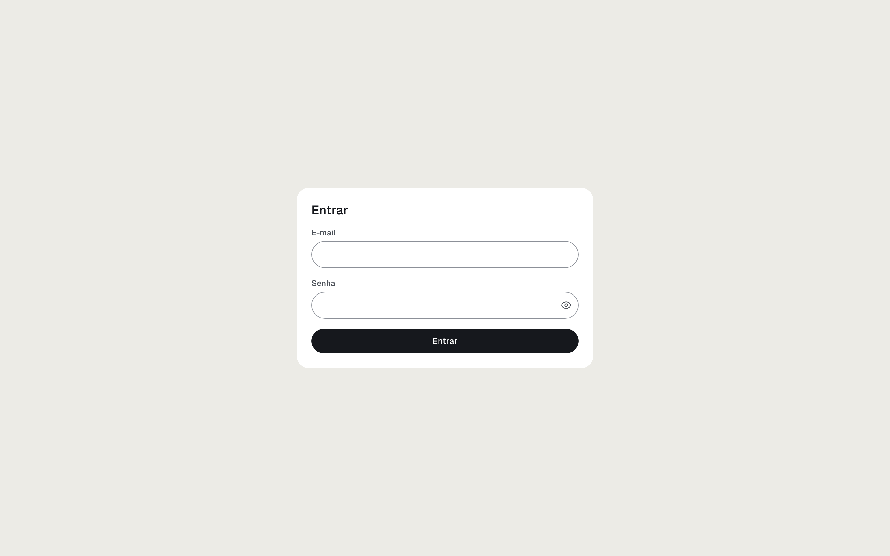 |
| Entrar · erro genérico | 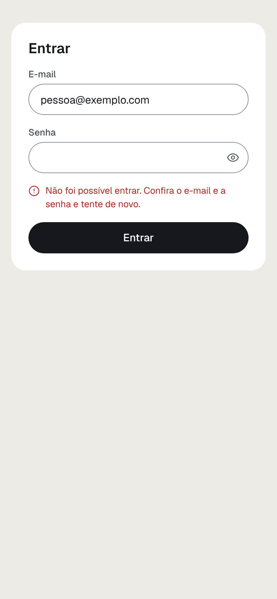 | 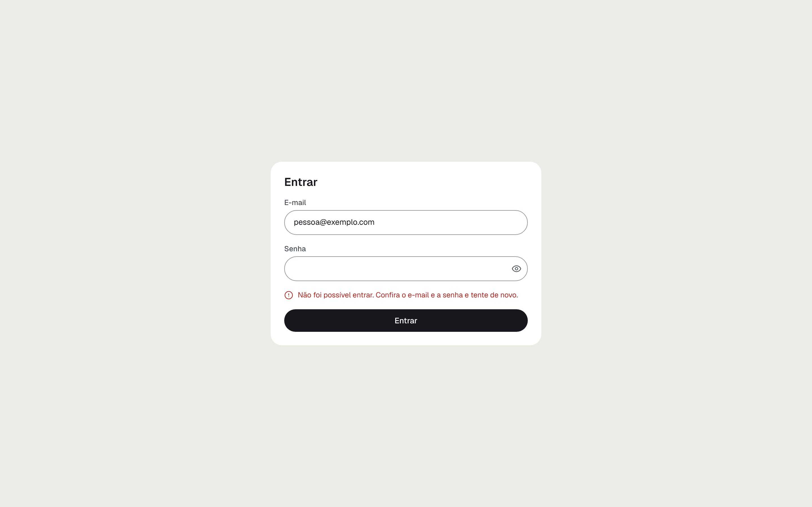 |
| Entrar · carregando | 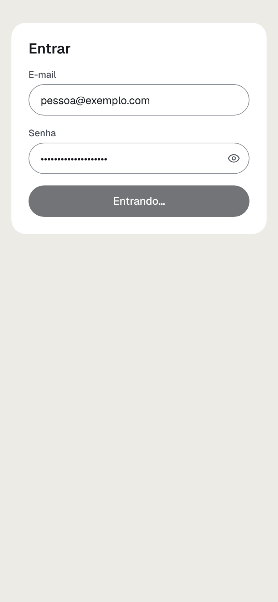 |  |
| Escolher estúdio · 2 estúdios | 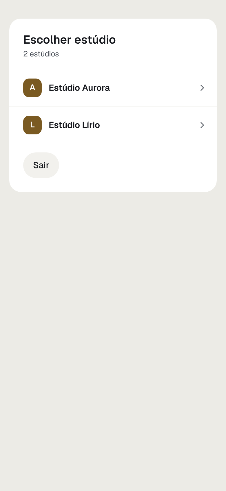 |  |
| Entrar · senha mostrada (`eye-off`, "Esconder senha") | 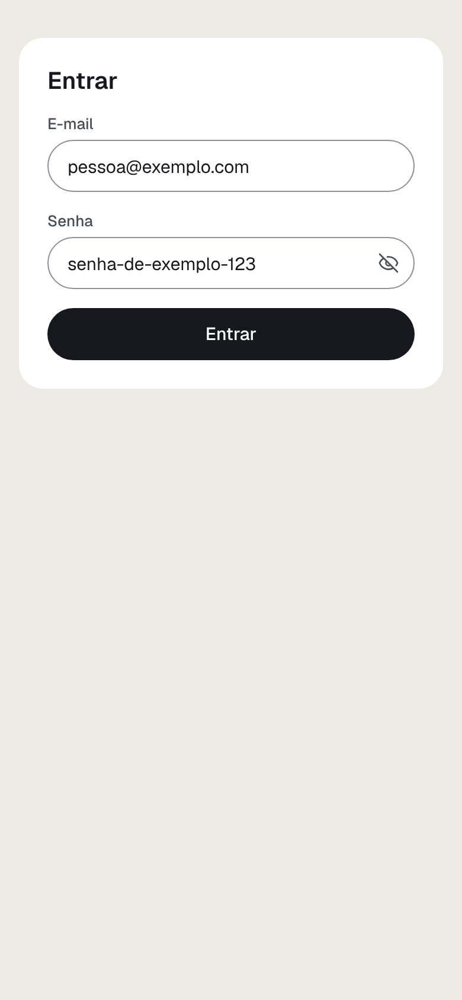 | 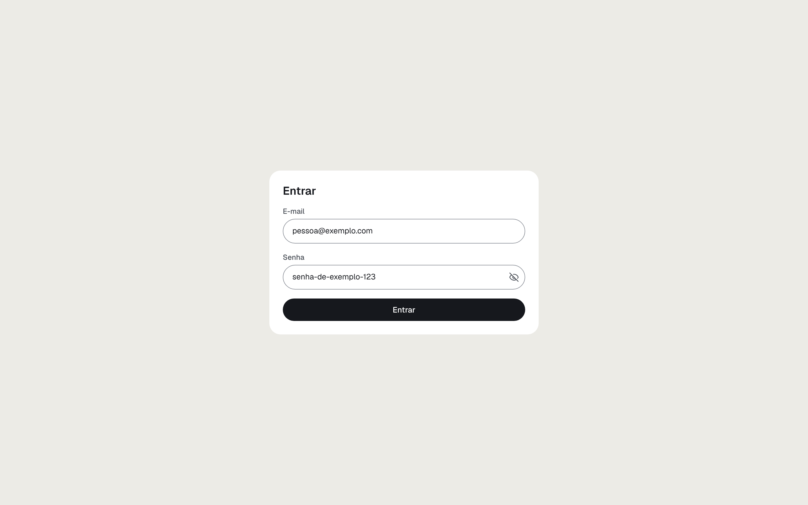 |
| Entrar · foco no campo Senha depois do erro (anel 2 px) |  | 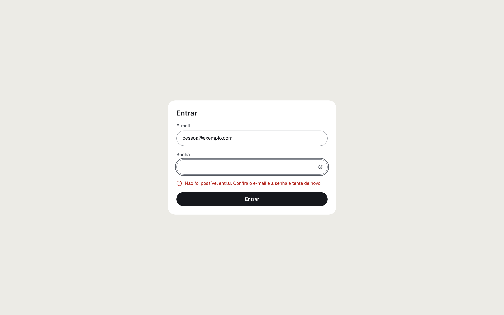 |
| Escolher estúdio · carregando | 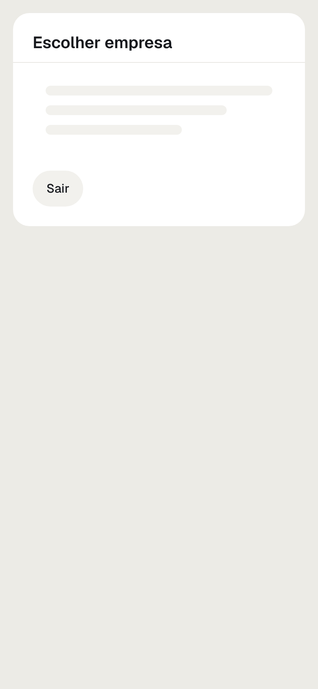 | 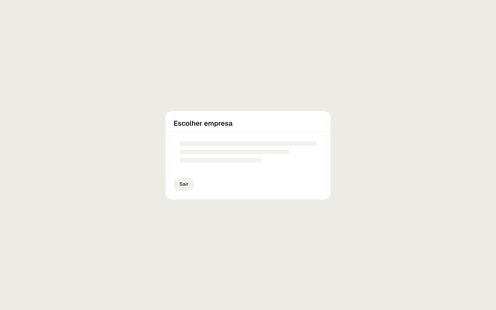 |
| Escolher estúdio · erro ("Tentar de novo") | 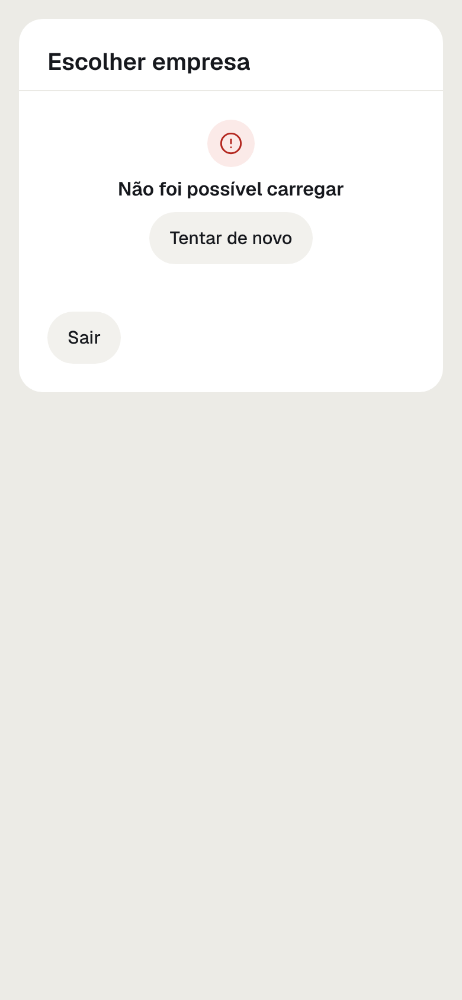 | 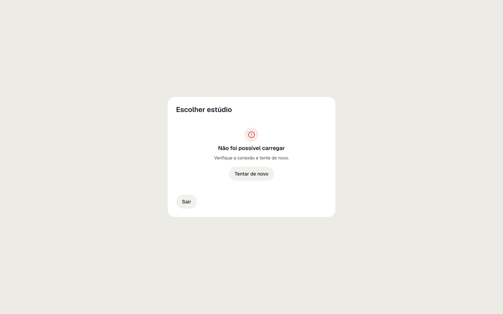 |
| Sua conta · com "Trocar de estúdio" (folha no celular, menu no computador; inicial "P" na bolinha) | 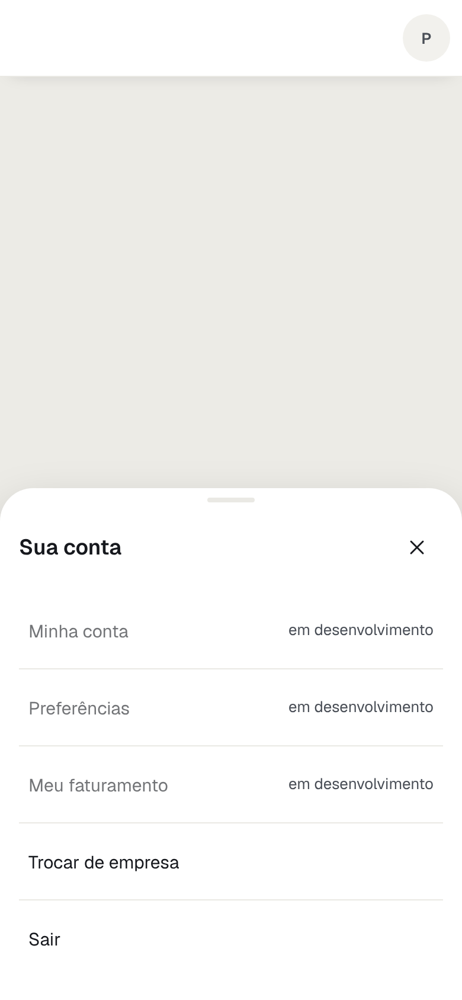 | 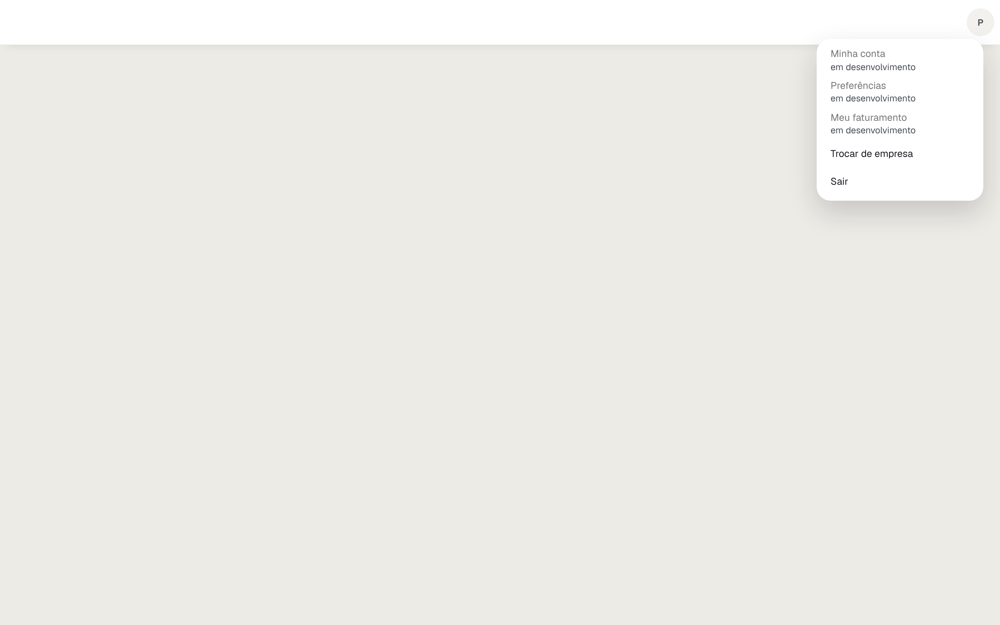 |
| Sua conta · sem "Trocar de estúdio" (um estúdio só) | 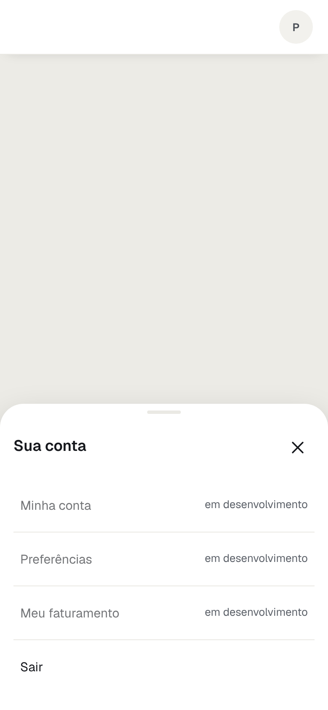 | 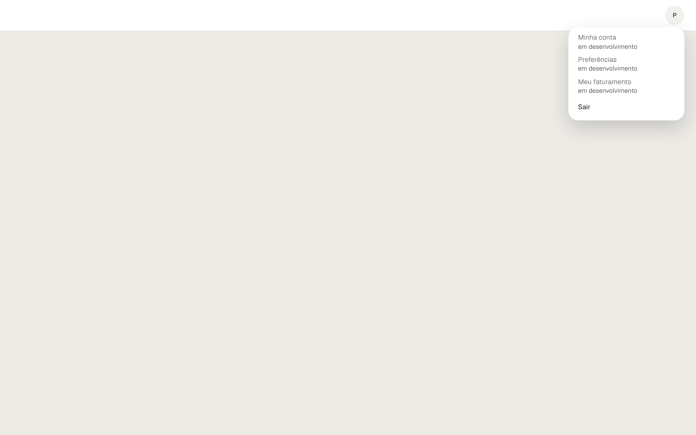 |

As 8 primeiras são da 1ª rodada; as 12 seguintes, da 2ª (pedido do Revisor de design).

**Comportamento (para quem constrói e para o e2e):**
- **Depois do erro:** o foco vai para o campo Senha, que fica limpo; o e-mail continua escrito. A frase de erro é
  anunciada (`role="alert"`).
- **Carregando ao entrar:** o botão usa `aria-disabled="true"` e `aria-busy="true"` (não `disabled`, para não perder o
  foco nem sumir do leitor) e o texto "Entrando…" também vai a uma área de anúncio (`role="status"`). O botão do olho
  trava junto (`aria-disabled`); os campos ficam só leitura. As imagens de "carregando" da 1ª rodada foram feitas com
  `disabled`; o desenho é o mesmo (60 %), só o atributo muda.
- **Limite de tentativas (CA-14):** a mesma frase genérica de E41·1 e o mesmo desenho do "erro genérico"; não há tela
  nem texto próprio, para não dizer o motivo.
- **Escolher estúdio:** o nome acessível de cada linha é o nome do estúdio ("Estúdio Aurora"); o quadrado da inicial e
  a seta › são enfeite (`aria-hidden`). Carregando: linhas cinza do §8 (depois de 0,3 s), anunciadas como
  "Carregando estúdios". Erro: estado de erro do §8, só o título do erro ("Não foi possível carregar") e "Tentar de novo", com "Sair"
  embaixo; sem frase de detalhe.
- **Para a T2 (campos):** e-mail com `autocomplete="email"` e Senha com `autocomplete="current-password"` (WCAG 1.3.5).
  O botão do olho muda o nome ("Mostrar senha" / "Esconder senha") e **não** usa `aria-pressed` (WCAG 4.1.2).
- **Sua conta:** itens na ordem do §8b; Minha conta, Preferências e Meu faturamento esmaecidos com "em
  desenvolvimento" ao lado (celular) ou embaixo (computador, porque 240 não cabe numa linha), com `aria-disabled`;
  "Trocar de estúdio" só com mais de um estúdio. Bolinha com a inicial "P" = primeira letra do e-mail da própria
  pessoa (proposta do `plan.md` L-4; entra em E41·1 junto dos nomes).

**O que já segue o `DESIGN.md` sem decisão nova:** fundo `--page` e bloco branco canto 20 (§2: nenhum controle direto
sobre o fundo) · título 20 forte · campos em pílula, 44, rótulo acima em `--ink2`, contorno `--field` (§4, §8, §8b) ·
uma só ação preta, "Entrar" (§1, §5) · erro com ícone `circle-alert` e palavra em `--danger` (§8) · desativado a 60 %
(§8) · linha de lista 64 com o quadrado da inicial do estúdio (canto 10, `--brand`) e › (§3, §4) · contador no
subtítulo com número e palavra, "2 estúdios" (§5) · anel de foco do item 4 · toque 44/40 (§9).

### E41·1 · Nomes novos (entram no `DESIGN.md` §6)
Botão **Entrar** · rótulos **E-mail** e **Senha** · título **Escolher estúdio** · botão **Sair** · estado
**Entrando…** · nome do ícone de olho **Mostrar senha** / **Esconder senha** (leitor de tela) · frase de erro
**"Não foi possível entrar. Confira o e-mail e a senha e tente de novo."**
- **E41·1·A:** aceitar todos como estão → entram no §6 e nos arquivos de idioma (pt; es e en traduzidos).
- **E41·1·B:** aceitar e trocar algum (inclui a inicial da bolinha Sua conta = primeira letra do e-mail) → diga qual e o novo texto.
- **Recomendo A.** "Sair" já está no §8b (menu Sua conta) e o §6 só o barra como sinônimo de Fechar/Cancelar; aqui é
  encerrar a sessão, que é outro sentido. A frase não diz qual parte falhou (spec RF-02, ASVS V2.2).

### E41·2 · Mostrar e esconder a senha (peça e ícones novos)
- **E41·2·A:** botão de ícone sem fundo dentro do campo, à direita: `eye` (mostrar) e `eye-off` (esconder), com nome
  no leitor; os dois ícones entram no mapa de ícones do §5.
- **E41·2·B:** botão de texto "Mostrar" / "Esconder" dentro do campo.
- **Recomendo A:** segue a regra de botão de ícone (§5: sem fundo, com nome) e ocupa menos espaço no celular; o olho
  é padrão reconhecido (Material Design, Apple HIG). Atende RF-32 e WCAG 2.2 3.3.8 (colar a senha continua permitido).

### E41·3 · Onde fica o erro e como fica o carregando
- **E41·3·A (o das imagens):** erro numa linha só, acima de "Entrar", com ícone e texto vermelhos, anunciado ao leitor
  (`role="alert"`); os campos **não** ficam com contorno vermelho; o e-mail fica, a senha é limpa. Carregando: o botão
  fica esmaecido com "Entrando…" (anunciado), os campos travam; sem linhas cinza.
- **E41·3·B:** contorno vermelho nos dois campos, com a frase embaixo da Senha; carregando com as linhas cinza do §8.
- **Recomendo A:** o §8 manda contorno vermelho para erro **de um campo**; aqui não se pode dizer qual falhou (RF-02),
  e marcar os dois engana. Linhas cinza substituiriam o formulário que a pessoa acabou de preencher; botão travado
  também evita envio em dobro.

### E41·4 · Molde das telas sem menu
- **E41·4·A (o das imagens):** um bloco branco só; no computador, 480 de largura (a medida do painel, §8b), centrado
  na tela; no celular, largura toda com margem 16, no alto. Sem nome do sistema nem logotipo (o `DESIGN.md` não tem).
  Escolher estúdio: a lista é a ação (sem botão preto); "Sair" claro no fim do bloco.
- **E41·4·B:** o mesmo, com o nome do sistema acima do bloco (texto a definir pelo dono; entra no `DESIGN.md`).
- **Recomendo A:** usa só medidas que já existem e não inventa marca. Entra no `DESIGN.md` como "tela sem menu".

### Ressalvas da 2ª rodada (Revisor de design) · resolvidas
- Tirada a frase "Verifique a conexão e tente de novo." do erro de Escolher estúdio: fica só o título do erro e
  "Tentar de novo" (§8). As imagens `ficha/escolher-estudio-erro-390.png` e `-1440.png` ainda mostram a frase; não
  foram refeitas, **vale o texto desta ficha**.
- Anotados para a T2: `autocomplete` nos campos (WCAG 1.3.5) e o nome do botão do olho sem `aria-pressed` (WCAG 4.1.2).
- Em aberto, sem mudança: folha Sua conta sem véu no celular (ver "Não verificado").

**Desfaz-se assim:** mudar o texto ou a peça no `DESIGN.md` e no arquivo de idioma; as telas leem dali.
**Responda:** os códigos, por exemplo "E41·1·A E41·2·A E41·3·A E41·4·A". O "sim" vem junto da aprovação da spec
(`tasks.md` P4); com ele, o Designer grava os nomes e as peças no `DESIGN.md`.

---

## Não verificado
- **Limite de tentativas:** sem imagem própria; usa o mesmo desenho do erro genérico (descrito acima).
- **Folha Sua conta no celular:** sem véu escuro atrás, porque o `DESIGN.md` não define um (igual ao componente do item
  4). Assunto em aberto, sem mudança nesta tarefa.
- **Imagens do erro de Escolher estúdio:** mostram a frase de detalhe que saiu; não refeitas.
- **Fundo das telas de Sua conta:** só a barra com a bolinha; a página inicial real é do item 2 e não foi desenhada.
- **Acessibilidade:** axe (wcag2a, wcag2aa, wcag21aa, wcag22aa) deu 0 violações no protótipo, nas 20 capturas; não é o
  app real. Não conferi com leitor de tela de verdade nem foco por teclado. O texto "Entrando…" esmaecido (60 %) fica
  abaixo de 4,5:1; a WCAG isenta controle desativado, mas o Revisor deve olhar.
- **Textos em es e en:** não escritos aqui (são do arquivo de idioma, na construção).
- O protótipo não é código do app: o campo Senha com olho ainda não existe em `src/app/ui/campos.tsx` (plano §7: só
  depois da aprovação).
